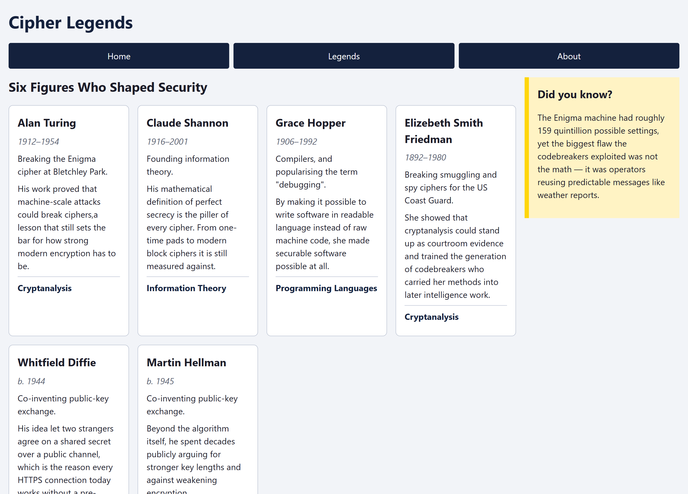
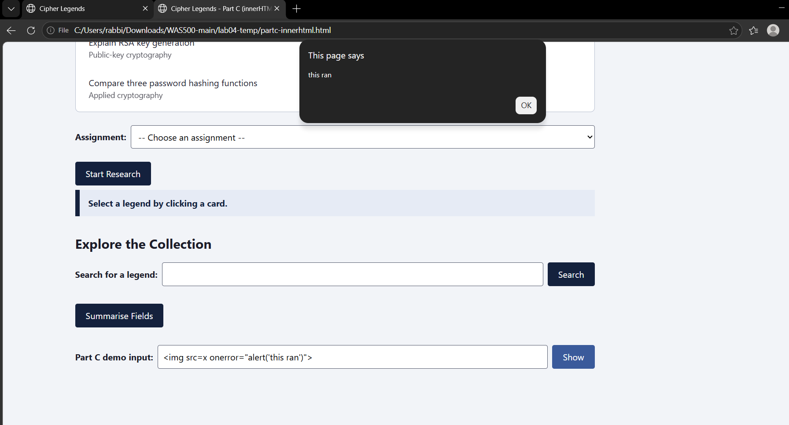
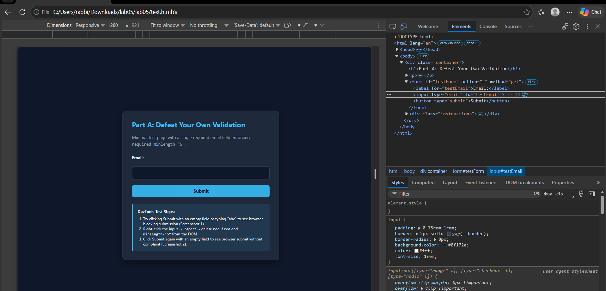

<div align="center">

# 🌐 WAS500 — Web Application Security

**Building the *Cipher Legends* site lab by lab, with a web-security lesson at each step**


**[▶ Live demo](https://rabbiaman03.github.io/was500-web-app-security/)**

</div>

---

## 📌 Overview

Coursework from **WAS500 (Fall 2026, Seneca Polytechnic)**. Each lab extends **Cipher Legends**, a responsive gallery of cryptography and computer-security pioneers, and teaches a security concept along the way. Every lab folder has the full source code and a written report with screenshots.

## 🔬 Labs

| # | Lab | Security angle | Report | Demo |
|---|---|---|---|---|
| 01 | HTML and CSS fundamentals, DNS and the HTTP request cycle | How a page is found and loaded; W3C validation | [Report](lab01/README.md) | [Open](https://rabbiaman03.github.io/was500-web-app-security/lab01/) |
| 02 | Semantic HTML5 and responsive, accessible layout | Accessibility: skip link, focus states, keyboard audit | [Report](lab02/README.md) | [Open](https://rabbiaman03.github.io/was500-web-app-security/lab02/) |
| 03 | JavaScript basics and interactivity | Type coercion, scope and hoisting pitfalls; debugging | [Report](lab03/README.md) | [Open](https://rabbiaman03.github.io/was500-web-app-security/lab03/) |
| 04 | DOM manipulation and events | **XSS:** script injection through `innerHTML` vs safe `textContent` | [Report](lab04/README.md) | [Open](https://rabbiaman03.github.io/was500-web-app-security/lab04/) |
| 05 | Client-side validation and UX | **Bypassing HTML5 validation in DevTools**: why the server must always validate | [Report](lab05/README.md) | [Open](https://rabbiaman03.github.io/was500-web-app-security/lab05/) |
| 06 | **Node.js server from scratch:** routing, file I/O, blocking vs non-blocking | **Server-side validation:** tampered requests get rejected with `400`; passwords never stored | [Report](lab06/README.md) | Run locally (`node server.js`) |
| 07 | **Express REST API:** CRUD under `/api/v1`, middleware stack, filtering, sorting and pagination | **`helmet`, CORS and rate limiting (`429`)**, validation that rejects unexpected fields, no stack traces in production | [Report](lab07/README.md) | Run locally (`npm run dev`) |
| 08 | **MongoDB and Mongoose:** data modelling (embed vs reference), shell CRUD, a Mongoose schema with validation | **Layers of validation:** the shell accepts any shape, Mongoose rejects bad documents in Node, a unique index is enforced by the database; connection string kept in `.env` | [Report](lab08/README.md) | Run locally (`npm run seed`) |
| **A1** | **Assignment 1: Cipher Machines museum.** A 3-page site with a data-driven gallery, filters and a validated membership form | Accessible components (`aria-expanded`), strict input validation, zero W3C errors | [Report](assignment01/README.md) | [Open](https://rabbiaman03.github.io/was500-web-app-security/assignment01/) |

## 🖼️ Screenshots

| Responsive layout (1280 px) | `innerHTML` injection | Validation bypass |
|---|---|---|
|  |  |  |

## 🔑 Key takeaways

- **The server is the real gate.** In Lab 06 my own Node server rejected input that I had pushed past the browser's validation.
- **Never trust the client.** `required`, `minlength` and `type="email"` can be deleted in DevTools in seconds, so validation must be repeated on the server.
- **Prefer `textContent` over `innerHTML`** for untrusted data. `innerHTML` parses markup and allows injected event-handler scripts to run.
- **Accessibility is part of quality:** semantic landmarks, visible focus styles and skip links.

## ▶️ Run locally

No build step. Open any `labXX/index.html` in a browser, or run:

```bash
python -m http.server 8000   # then visit http://localhost:8000/lab05/
```

---

<sub>Author: <b>Rabbi Muhammad Aman</b> · Academic coursework.</sub>
