# Assignment 01 - Cipher Machines: A Museum of Historical Cryptography
- **Author**: Rabbi Muhammad Aman
- **Date**: 2026-10-13

**[▶ Live demo](https://rabbiaman03.github.io/was500-web-app-security/assignment01/)**

## What I built (summary)

A three-page, responsive and accessible museum site about six historical cipher machines (Enigma, Lorenz and others), built with plain HTML, CSS and JavaScript and **no frameworks or image files**.

| Area | What I did |
|---|---|
| **Data-driven UI** | All six machine cards are generated from a single JavaScript array with `document.createElement`. The gallery, the era filter and the form's dropdown all read from the same data, so adding a machine means editing one place |
| **Interactivity** | Expand/collapse cards using native `<button>`s with `aria-expanded` and `aria-controls`; an era filter that announces how many machines are showing; deep links (`machines.html#machine-enigma`) that open and scroll to the right card |
| **Form validation** | `novalidate` plus custom real-time validation on `input`: trimmed lengths, a stricter email check than the browser's, number range and step, and a live "Add 12 more characters" counter. Invalid submissions are blocked, with specific messages |
| **Layout** | Mobile-first. CSS Grid gallery with `repeat(auto-fit, minmax(min(100%, 17rem), 1fr))`, which avoids horizontal scrolling at 320px; Flexbox navigation that switches from column to row at 768px |
| **Accessibility** | Full keyboard audit, visible focus styles, labelled fields, and a decorative CSS-only rotor marked `aria-hidden`. I found and fixed an invalid `role="button"` on `<article>` |
| **Quality** | One shared stylesheet and one shared script for all pages; **zero W3C validator errors** on all three pages |

| Home (1280px) | Collection (768px) | Form validation |
|---|---|---|
| 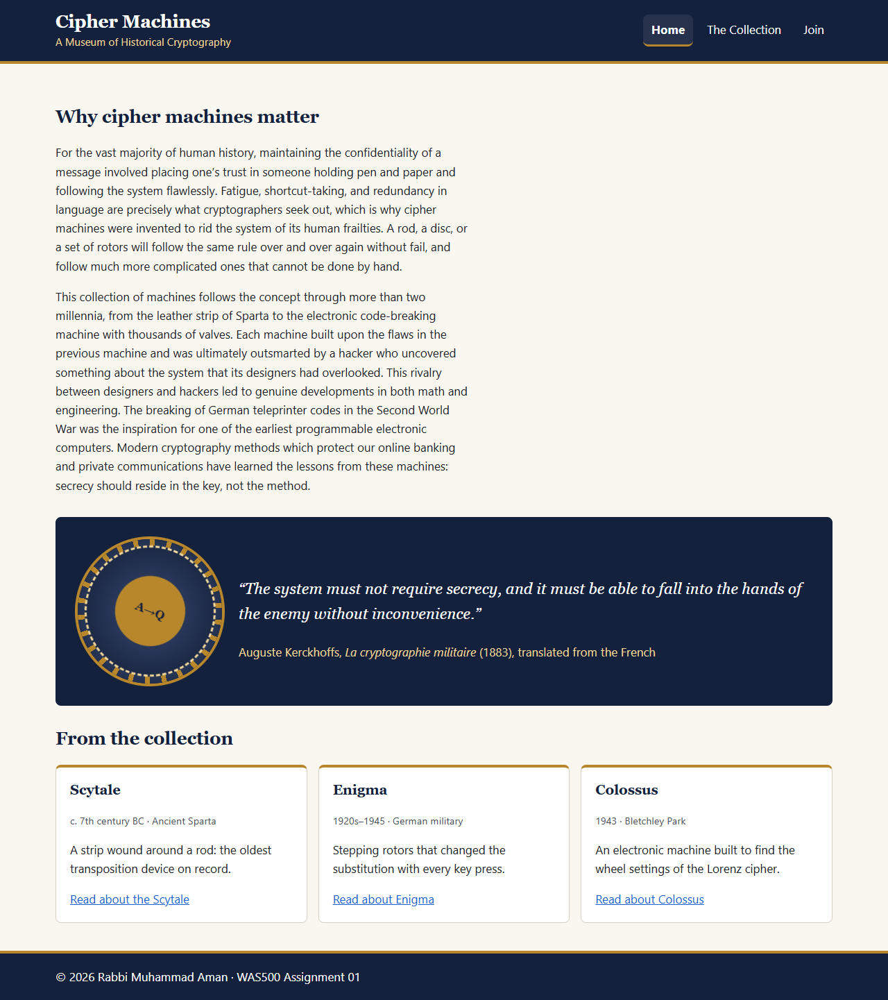 | 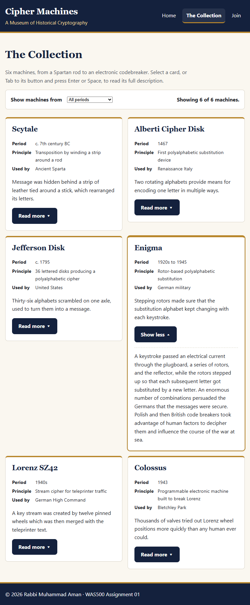 | 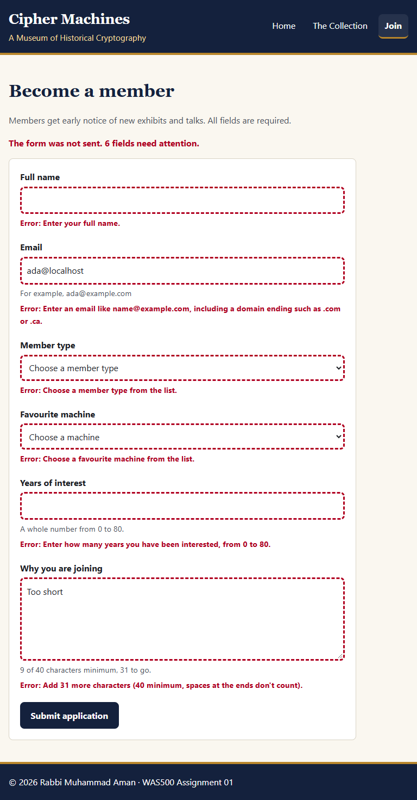 |

The full assignment report follows below.

---

## Table of Contents
1. [Introduction](#introduction)
2. [Code Block Deliverables](#code-block-deliverables)
3. [Screenshots Deliverables](#screenshots-deliverables)
4. [Keyboard Audit](#keyboard-audit)
5. [Image Credits](#image-credits)
6. [Design Decisions](#design-decisions)
7. [Experience and Challenges](#experience-and-challenges)

---

## Introduction

This assignment is a three-page website about six historical cipher machines:

| Page | Purpose |
|---|---|
| `index.html` | Home: site `<h1>`, a 150+ word introduction, a CSS-built rotor graphic with a quotation, and previews of three machines that link to their cards |
| `machines.html` | The collection: six cards rendered from a JavaScript array with `document.createElement`, in a CSS Grid gallery using `repeat(auto-fit, minmax(...))`. Each card expands and collapses, and an era filter reports how many machines are showing |
| `join.html` | Membership form with six labelled fields, HTML5 constraints, custom JavaScript validation on `input`, a live character counter and a confirmation message |

All three pages share one stylesheet (`styles.css`) and one script (`script.js`). The script checks which elements exist on the page and only runs the code for that page.

---

## Code Block Deliverables

### Deliverable 1: Machine data array (`script.js`, first entry shown)
```javascript
const machines = [
  {
    id: "scytale",
    name: "Scytale",
    period: "c. 7th century BC",
    era: "Antiquity",
    principle: "Transposition by winding a strip around a rod",
    usedBy: "Ancient Sparta",
    summary: "...",
    description: "..."
  },
  // ...five more machines
];
```

### Deliverable 2: Card toggle with `aria-expanded` (`script.js`)
```javascript
function setCardExpanded(card, expanded) {
  const button = card.querySelector(".card-toggle");
  const description = card.querySelector(".description");
  button.setAttribute("aria-expanded", String(expanded));
  button.querySelector(".toggle-label").textContent = expanded ? "Show less" : "Read more";
  description.hidden = !expanded;
  card.classList.toggle("is-expanded", expanded);
}
```

### Deliverable 3: Filter that reports the count (`script.js`)
```javascript
function applyFilter(gallery, era) {
  const cards = gallery.querySelectorAll(".machine-card");
  let shown = 0;
  cards.forEach((card) => {
    const matches = era === "all" || card.dataset.era === era;
    card.hidden = !matches;
    if (matches) {
      shown += 1;
    }
  });
  return describeCount(shown, cards.length);
}
```

### Deliverable 4: Grid gallery and Flexbox navigation, mobile-first (`styles.css`)
```css
.gallery {
  display: grid;
  grid-template-columns: repeat(auto-fit, minmax(min(100%, 17rem), 1fr));
  gap: 1rem;
}

.nav-list {
  display: flex;
  flex-direction: column;   /* stacked on narrow screens */
}

@media (min-width: 768px) {
  .nav-list {
    flex-direction: row;    /* row from 768px up */
  }
}
```

### Deliverable 5: Blocking an invalid submission (`script.js`)
```javascript
function handleSubmit(event, form, confirmation, status, counter) {
  event.preventDefault();
  const invalidFields = getInvalidFields(form);

  if (invalidFields.length > 0) {
    const count = invalidFields.length;
    status.textContent = `The form was not sent. ${count} field${count === 1 ? " needs" : "s need"} attention.`;
    confirmation.hidden = true;
    invalidFields[0].focus();
    return;
  }

  confirmation.textContent = buildConfirmation(form);
  confirmation.hidden = false;
  status.textContent = "";
  form.reset();
  clearFieldStates(form);
  counter.textContent = getCounterText(0);
  confirmation.focus();
}
```

---

## Screenshots Deliverables

Full-page screenshots taken in Chrome with the viewport set to exactly 320px, 768px and 1280px.

### Deliverable 6: index.html at 320px, 768px and 1280px
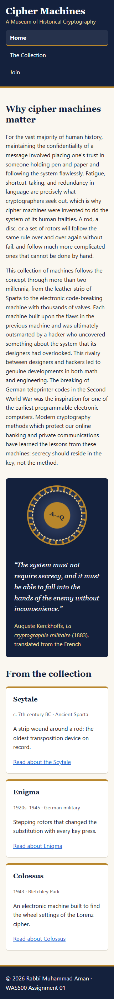
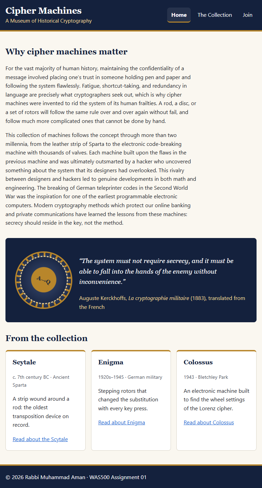


### Deliverable 7: machines.html at 320px, 768px and 1280px
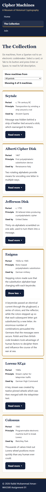

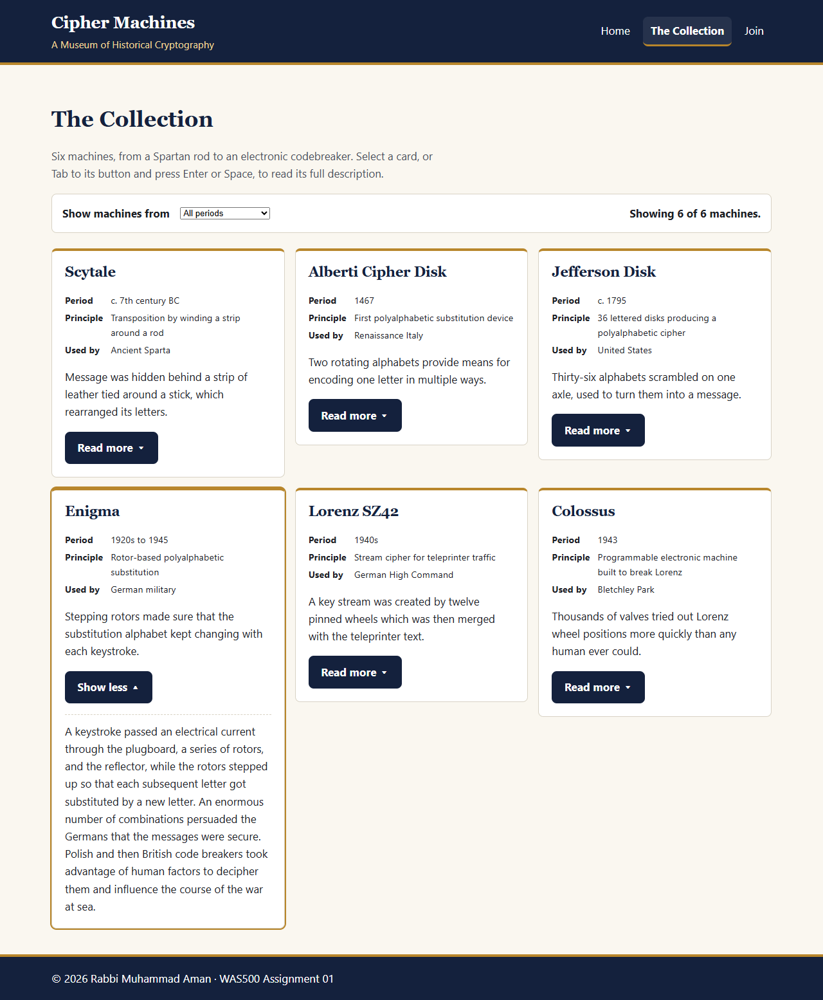

### Deliverable 8: join.html at 320px, 768px and 1280px
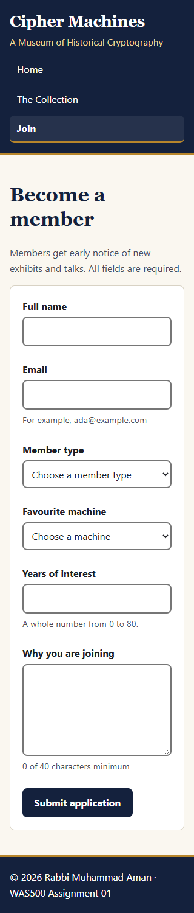
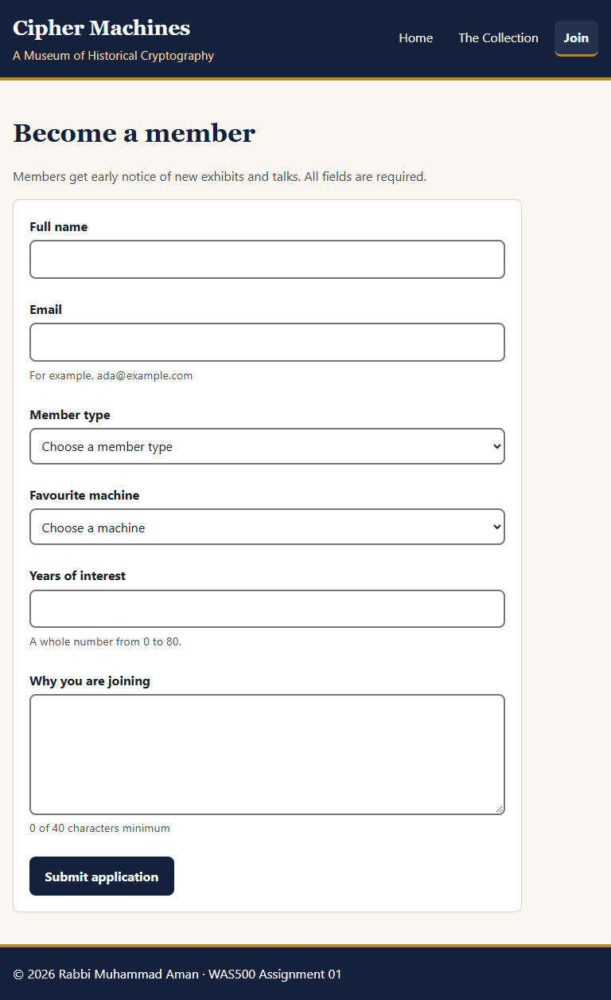
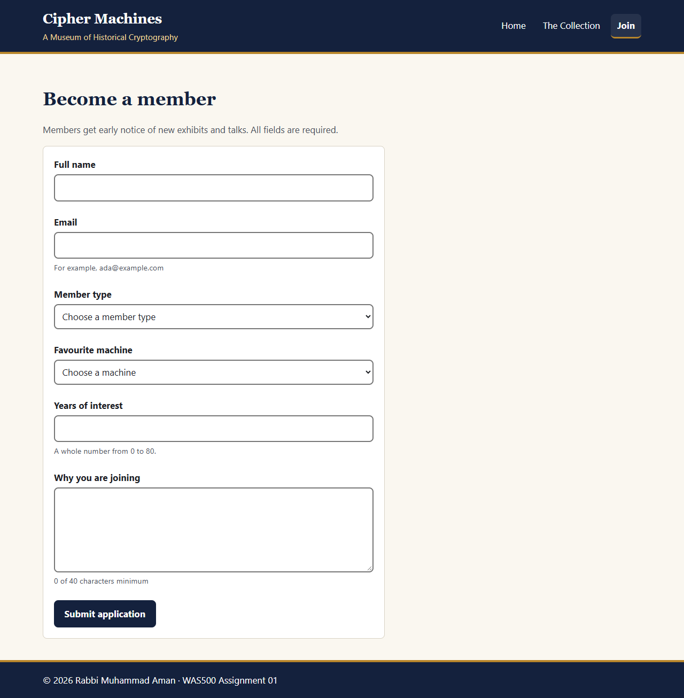

### Deliverable 9: W3C validation, zero errors on all three pages
Each page was pasted into the [W3C Nu HTML Checker](https://validator.w3.org/nu/#textarea).

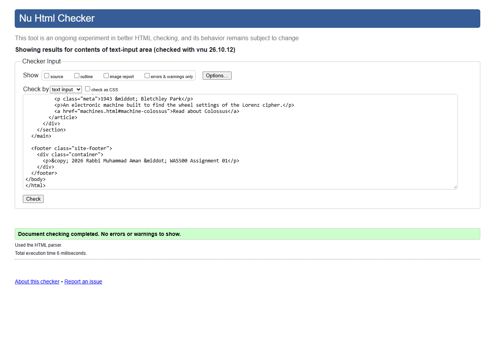
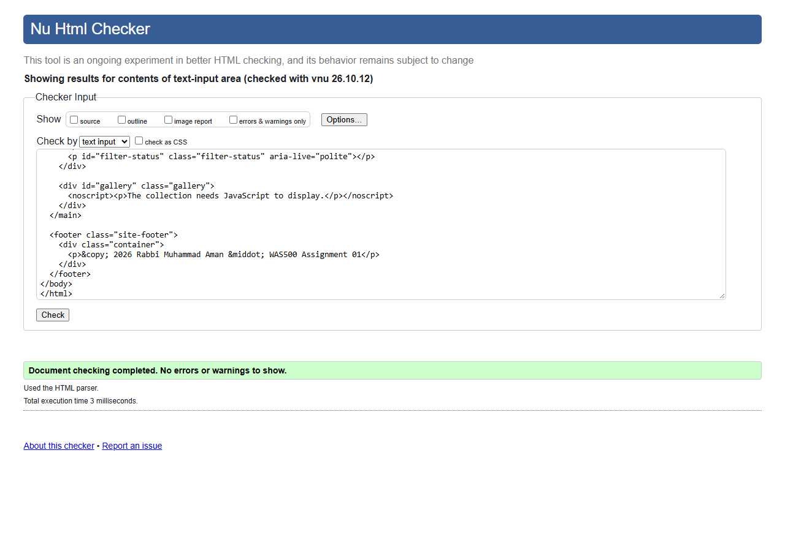
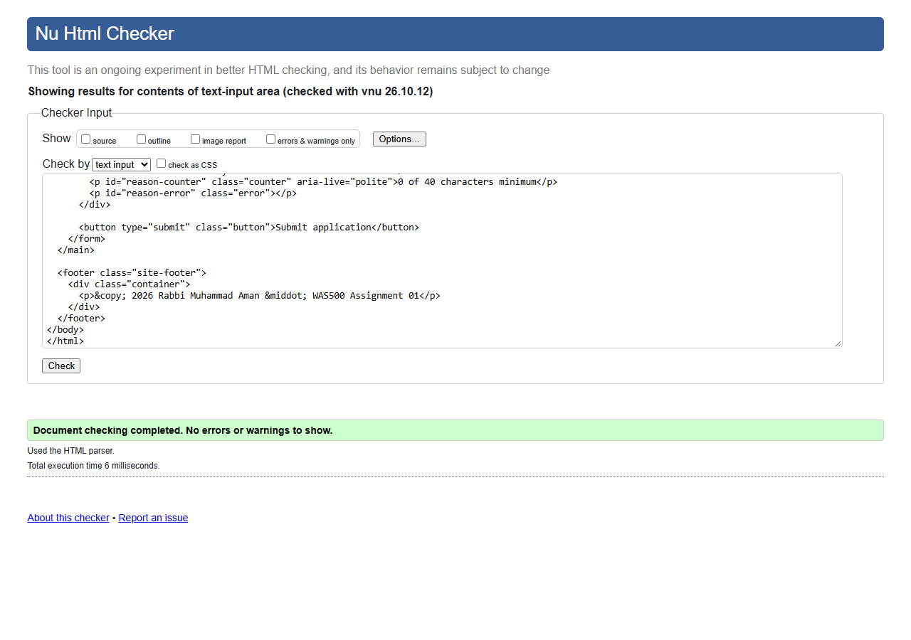

### Deliverable 10: Form validation failing
This form had `ada@localhost` in the Email field, "Too short" as Reason, and all other fields left blank. The form submission is prevented using `preventDefault()`. All fields display their respective error message starting from "Error:" alongside, which are connected using `aria-describedby`, and the focus is shifted to Full name. Invalid fields have a thick dotted border, and thus the status is not dependent on color alone.


### Deliverable 11: Form validation succeeding
A valid submission shows a confirmation naming the applicant, member type and favourite machine. The form and counter are reset, and focus moves to the confirmation.

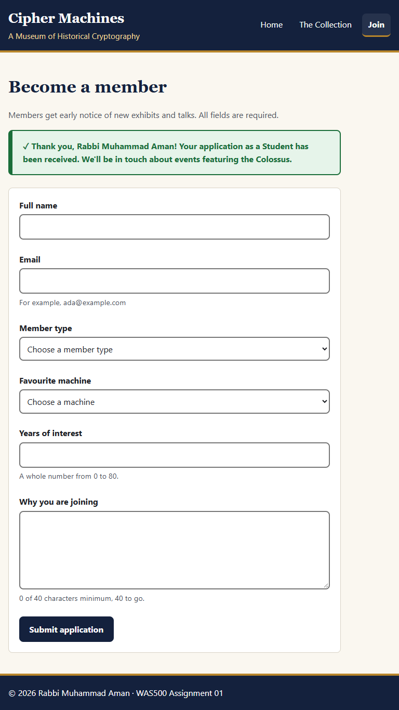

---

## Keyboard Audit

Page audited: `machines.html`, starting from the address bar and pressing Tab.

| # | Element | Notes |
|---|---|---|
| 1 | "Skip to main content" link | Appears at the top-left when focused; Enter moves focus to `<main>` |
| 2 | Home (nav) | |
| 3 | The Collection (nav) | `aria-current="page"`, bold with a brass underline |
| 4 | Join (nav) | |
| 5 | "Show machines from" select | Arrow keys change the era; the count updates and is announced |
| 6 | Read more about Scytale | Enter or Space toggles; `aria-expanded` switches between `false` and `true` |
| 7 | Read more about Alberti Cipher Disk | |
| 8 | Read more about Jefferson Disk | |
| 9 | Read more about Enigma | |
| 10 | Read more about Lorenz SZ42 | |
| 11 | Read more about Colossus | Last focusable element; the footer has no links |

**Was it logical?** Sure. Focus traverses from top to bottom and then from left to right within the grid just like a sighted user would do. Focus is never stuck and is always highlighted using the 3px outline style. Cards that are filtered out use `hidden`, and therefore their buttons are not in the tab order.

---

## Image Credits

Image files have not been used. The rotor used on the homepage has been made using CSS gradients, borders, `border-radius` along with `aria-hidden="true"`, as the design of the rotor serves decorative purposes. The quote has been taken from Auguste Kerckhoffs, *La cryptographie militaire* (1883). The original work is available in the public domain.

---

## Design Decisions

### Grid and Flexbox
CSS Grid was employed whenever content is organized both vertically and horizontally. The gallery of collections utilizes `repeat(auto-fit, minmax(min(100%, 17rem), 1fr))`, thus allowing the browser to figure out how many cards fit there without having me write media queries for each width. The `min(100%, ...)` allows not to have a card trigger horizontal scrolling at 320px. The preview of images on the home page and the label-value pairs within a card are also grid layouts since they require items to align with each other.

The header, the navigation menu, the filters bar, and the form fields all are flex containers since these regions contain items that go in one direction only. Navigation on mobile devices utilizes `flex-direction: column` but then changes the direction to `row` at 768px wide screens. Flexbox allows to achieve the latter effect in one property and space the items with `gap`.

### Validation that needed JavaScript
The HTML5 attribute is where most of these basic requirements are stated: `required`, `minlength`, `type="email"`, `type="number"` with `min`, `max` and `step`. There are several requirements which still needed the use of JavaScript code. For example, the attribute `minlength` counts all the white spaces, meaning that "  A " will satisfy a two-character name requirement; the script will remove all the whitespaces before making the check. The browser treats `ada@localhost` as valid email address, so a regular expression needs also a domain name suffix like ".com". The 40-character counter has to be updated with each character input by the user; the message needs to be clear ("Add 12 more characters").

### An accessibility problem I found and fixed
The initial implementation made the `<article>` card focusable by using `tabindex="0"`, labeled as a button, and handled key presses of Enter and Space. While testing, issues were detected. Using `role="button"` was not valid for `<article>`, so there was a problem with validation. The card heading and facts were read as a single button name. Also, Space had to be special-handled so the page would not scroll. I used a native `<button>` with `aria-expanded` and `aria-controls` attributes instead. Native buttons handle Enter and Space automatically. Clicking anywhere on the card would toggle it, since the click event would bubble up to a single handler of the article.

I discovered another issue while testing links from the home page: `machines.html#machine-enigma` does not scroll to the card because cards are dynamically created. Now the script reads `location.hash` after creating the cards and opens and scrolls to the card.

---

## Experience and Challenges

- **What did you learn?** The ease of modification of the website increased due to the creation of cards from the same array. The same information is used for the formation of the gallery, the filter, and the favorite machine dropdown menu, so when you add the seventh machine, you have to edit only one thing. I've learned that the attribute has to be consistent with the real action.
- **Challenges Faced**: The real-time validation process can be very intimidating, and it can happen quite easily that you will have two different sets of errors (those from the browser itself and mine). The deep linking on the main page stopped working because the target was not there.
- **How You Overcame Challenges**: To make sure that only my messages were displayed and not those of HTML5 attributes, I added `novalidate` to the form. HTML5 attributes will remain the basic validation, and they will be checked through `field.validity`. Every field had one small function that either returned an error message or `""` depending on whether the value was correct or not. Regarding deep links, I did not use browser behavior.

---
