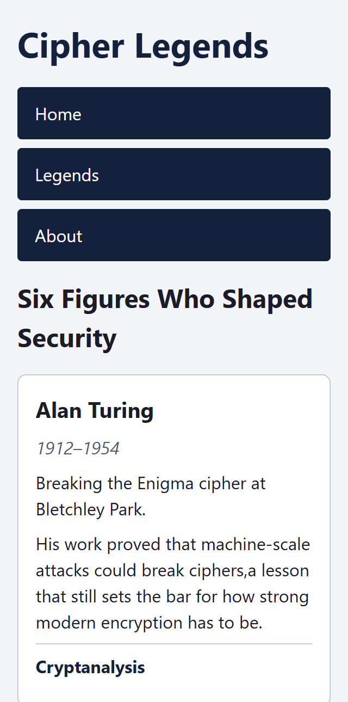
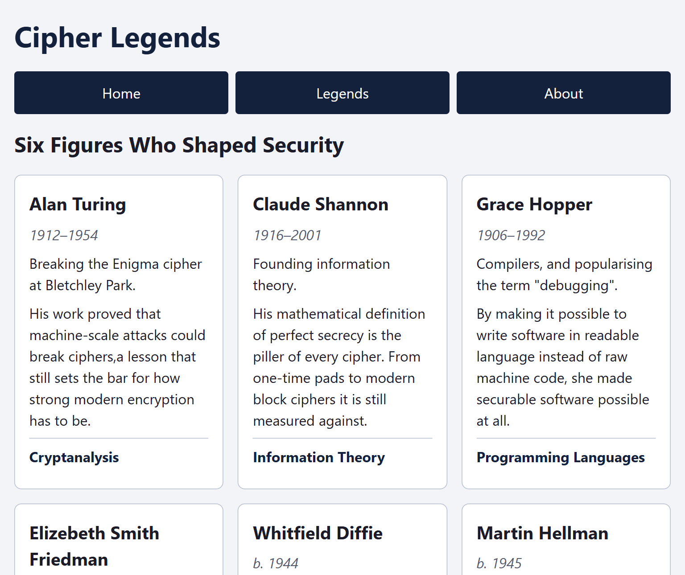
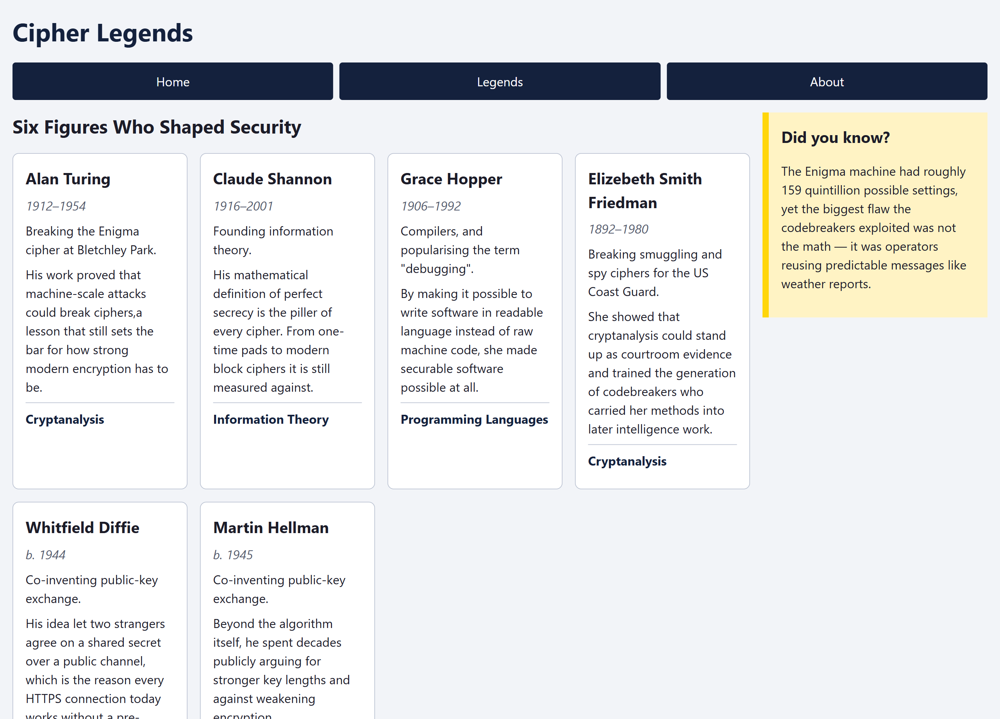
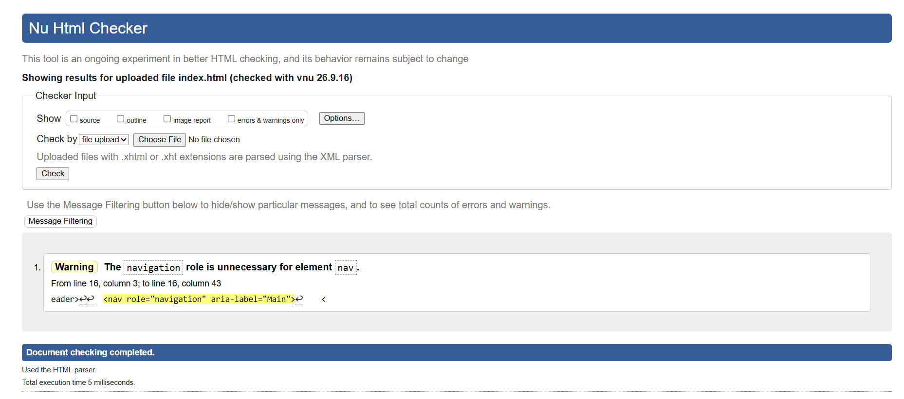

# Lab 02 - Responsive Layouts and Accessible Pages
- **Author**: Rabbi Muhammad Aman
- **Date**: 2026-09-23
---
## Table of Contents
1. [Introduction](#introduction)
2. [Part A - Semantic Structure](#part-a---semantic-structure)
3. [Part B - Layout Justification](#part-b---layout-justification-214)
4. [Keyboard Audit](#keyboard-audit)
5. [Screenshots Deliverables](#screenshots-deliverables)
6. [Experience and Challenges](#experience-and-challenges)
---
## Introduction
The lab consisted of two parts. In Part A, I redid a bunch of `<div>`-only code to use HTML5 semantically and justified why I chose each new element over `<div>` because of what it says about the content that `<div>` doesn't say. In Part B, I designed the responsive and accessible **Cipher Legends** website according to a spec: a one-page gallery featuring six historical figures of cryptography and computer security, coded with CSS Grid for the entire page and gallery layout, Flexbox for the navigation bar and the cards themselves, a mobile-first approach, and a keyboard-navigable skip link with proper focus states.

---
## Part A - Semantic Structure

### Deliverable 1: Rewritten snippet (2.2)
```html
<div class="page-wrapper">
  <header>
    <h1>Cipher Legends</h1>
    <nav>
      <ul>
        <li><a href="#">Home</a></li>
        <li><a href="#">Legends</a></li>
        <li><a href="#">About</a></li>
      </ul>
    </nav>
  </header>
  <main>
    <article>
      <div class="entry-inner">
        <h2>Alan Turing</h2>
        <p>Broke the Enigma cipher at Bletchley Park.</p>
      </div>
    </article>
    <aside>
      <h2>Did you know?</h2>
      <p>The word "cipher" comes from the Arabic sifr, meaning zero.</p>
    </aside>
  </main>
  <footer>
    <p>&copy; 2026</p>
  </footer>
</div>
```

### Deliverable 2: Element table (2.3)

| Original | Replaced with | Why |
|---|---|---|
| `div.top` | `<header>` | Marks the introductory/branding area of the page, so assistive tech can jump to it |
| `div.big-title` | `<h1>` | It is the page's main heading; a heading gives document outline, a div gives none |
| `div.links` | `<nav>` | Announces a block of navigation links as a landmark region |
| `div` around each link | `<li>` inside `<ul>` | Navigation is a list of items; a list tells a screen reader how many links there are and their position |
| `div.middle` | `<main>` | Identifies the primary content; only one per page, and skip-to-content tools target it |
| `div.entry` | `<article>` | A self-contained, independent piece of content that would still make sense on its own |
| `div.entry-title` | `<h2>` | A heading for the entry, sitting below the h1 in the document outline |
| plain `div` (description text) | `<p>` | It is a paragraph of text |
| `div.side` | `<aside>` | Content that is tangential/related to the main content, not part of it |
| `div.side-title` | `<h2>` | A heading for the aside content |
| plain `div` (side text) | `<p>` | A paragraph of text |
| `div.bottom` | `<footer>` | Footer information for the page or section |
| plain `div` (copyright) | `<p>` | A line of text |

### Deliverable 3: Which divs stay (2.4)
Elements `div.page-wrapper` and `div.entry-inner` will remain `<div>`. This is because both serve only a purpose of being containers for presentation information: `page-wrapper` sets constraints on page width and centers it, while `entry-inner` contains padding and border. Neither of them constitutes a separate piece of information, so there is no element that can describe them semantically, since applying something like `<section>` or `<article>` would make an incorrect statement about page semantics.

---
## Part B - Layout Justification (2.14)
The page level layout employs **Grid** as all of the header, nav, main, aside, and footer are being laid out in named areas, spanning across both rows and columns, i.e., desktop layout features a sidebar positioned next to the main area while header, nav and footer each occupy the full width, which can be described in two dimensions and not one that is required by Flexbox without additional wrapper element. The gallery layout employs **Grid** because the CSS rule of `repeat(auto-fit, minmax(14rem, 1fr))` allows the browser to fit an equal-width and equal-height number of columns within the available space, without any media query required. The navigation layout employs **Flexbox** because it is a one dimensional layout, as it represents a single row made out of three evenly-spaced links and collapse into a single stackable column on mobile. The card interior layout employs **Flexbox** because the layout represents a single column layout with margin-top auto pushing the field label to the bottom of the flex container.

---
## Keyboard Audit

### Deliverable 4: Focus order, first to last (2.22)
1. Skip to main content (skip link)
2. Home (nav)
3. Legends (nav)
4. About (nav)

### Analysis (2.23)
The order of focus was a logical one to begin with, as it proceeded in a top-down manner following the order in which the elements occurred in the HTML source code. In that case, since I created the HTML code in the same order in which it appeared visually, and since the CSS Grid code only changed the placement of `aside` in the visual space on wider screens without moving it in the source code, the visual order did not conflict with the tab order. The skip link occurs first in the `<body>` tag and is therefore always focused on first regardless of screen size.

---
##Screenshots Deliverables

##skip link focused


##320



##768



##1280



##validator



---
## Experience and Challenges
### Reflection on Completing the Lab
- **What did you learn?** I learned how to use CSS Grid for layout purposes, Flexbox for aligning components, and applying mobile first responsiveness and accessibility principles.
- **Challenges Faced**: Ensuring constant heights for the cards irrespective of the length of the text within them and positioning the skip link such that it remained invisible while using the mouse.
- **How You Overcame Challenges**: I have used Flexbox column layout along with auto margin (margin-top:auto) to align card footers consistently, and I have set absolute position with CSS focus states for the skip link.
