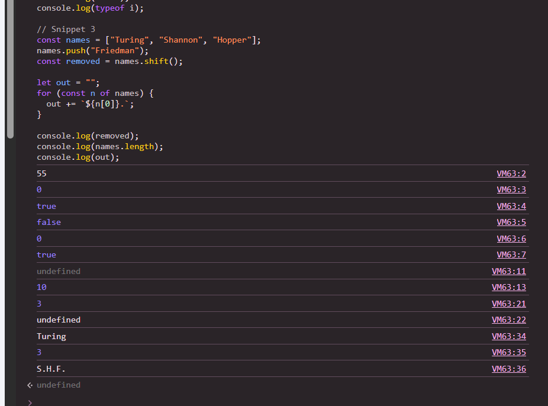
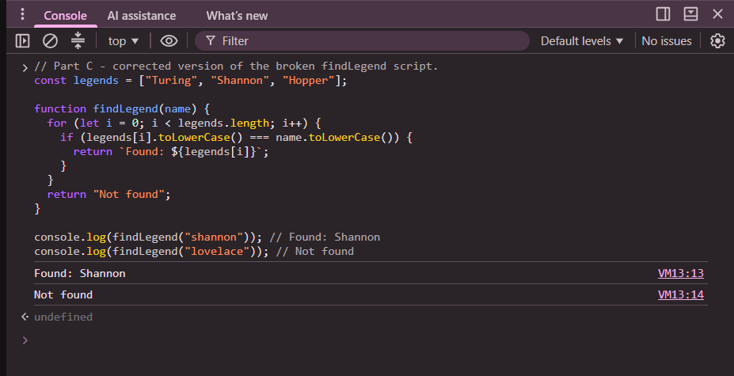
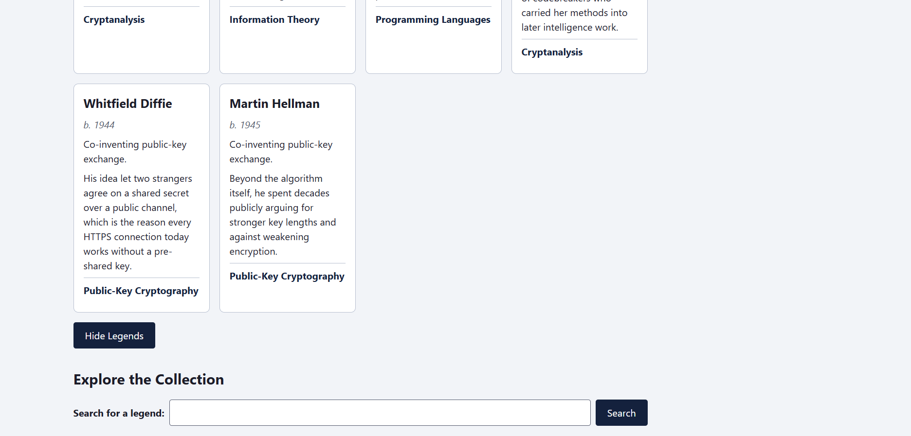
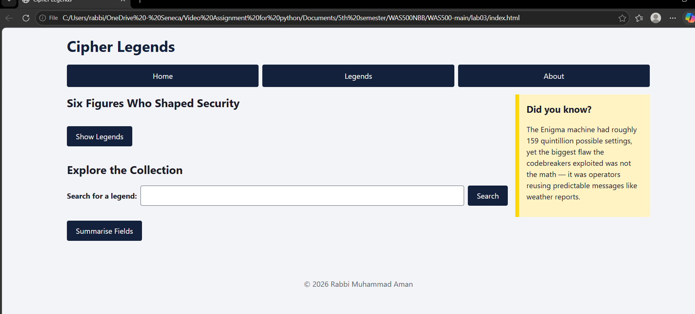
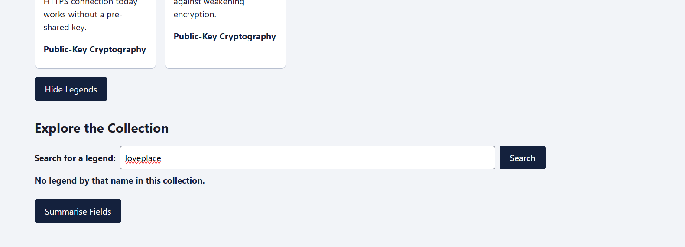
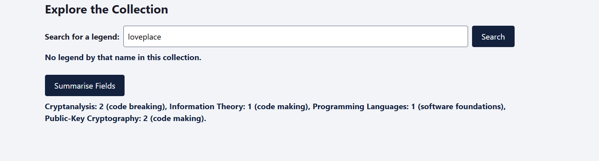

# Lab Submission Template
## Title: Lab 03 - Interactive Web Pages with JavaScript Basics
- **Name**: Rabbi Muhammad Aman
- 
- **Date**: 2026-10-01
---
## Table of Contents
1. [Introduction](#introduction)
2. [Part A - Predict, Then Verify](#part-a---predict-then-verify)
3. [Part B - Cipher Legends Interactivity](#part-b---cipher-legends-interactivity)
4. [Part C - Debug and Repair](#part-c---debug-and-repair)
5. [Screenshots Deliverables](#screenshots-deliverables)
6. [Experience and Challenges](#experience-and-challenges)
---
## Introduction
The lab was composed of three sections. Section A involved predicting the output of three JavaScript codes concerning type coercion, scope, and hoisting and explaining the output after executing them. Section B involved enhancing the Cipher Legends website created in Lab 02 by adding three interactive features, using the script.js file. They included a show and hide functionality for the gallery section, a case-insensitive legend search, and generation of a field summary using a loop. Section C entailed fixing five bugs in a non-functional search code and saving the new code as debug.js.

---
## Part A - Predict, Then Verify

I wrote my predictions first, then ran each snippet in the browser console (F12 → Console) and
recorded the actual output. Rows marked ✗ are the ones I predicted wrong.

### Snippet 1 - operators and type conversion

| Line | My prediction | Actual output | Explanation |
|---|---|---|---|
| `console.log(5 + "5")` | `55` ✓ | `55` | One operand is a string, so `+` converts 5 to `"5"` and joins them. |
| `console.log(5 - "5")` | `NaN` ✗ | `0` | I thought maths with a string would fail and give `NaN`. But `-` only works on numbers, so JavaScript converts `"5"` to 5; 5 − 5 = 0. |
| `console.log("5" == 5)` | `true` ✓ | `true` | `==` converts the string to a number before comparing. |
| `console.log("5" === 5)` | `false` ✓ | `false` | `===` also compares type; a string is never equal to a number. |
| `console.log(Number(""))` | `NaN` ✗ | `0` | I thought an empty string is not a number, so `NaN`. JavaScript converts an empty (or whitespace-only) string to 0. |
| `console.log(Boolean("false"))` | `false` ✗ | `true` | I read the word "false" and expected `false`. `Boolean()` does not read the text: every non-empty string is truthy, and only `""` is falsy. |

### Snippet 2 - scope and hoisting

| Line | My prediction | Actual output | Explanation |
|---|---|---|---|
| `console.log(x)` (before `var x = 10`) | An error (x is not defined) ✗ | `undefined` | I expected an error because `x` is used before it is declared. The `var x` declaration is hoisted to the top of `test()` with the value `undefined`; the assignment stays on its line. |
| `console.log(x)` (after) | `10` ✓ | `10` | The assignment has now run. |
| `console.log(count)` | `3` ✓ | `3` | The loop adds 0 + 1 + 2. |
| `console.log(typeof i)` | `number` ✗ | `undefined` (the string `"undefined"`) | I thought `i` would still be the number 3 after the loop. But `i` was declared with `let` in the `for` header, so it only exists inside the loop. `typeof` on a name that does not exist returns `"undefined"` instead of throwing. |

### Snippet 3 - arrays, loops, and template literals

| Line | My prediction | Actual output | Explanation |
|---|---|---|---|
| `console.log(removed)` | `Friedman` ✗ | `Turing` | I mixed up `shift()` with `pop()`. `pop()` removes the last element; `shift()` removes and returns the **first** one, which is Turing. |
| `console.log(names.length)` | `3` ✓ | `3` | 3 names + `push("Friedman")` = 4, then `shift()` removes one = 3. |
| `console.log(out)` | `T.S.H.` ✗ | `S.H.F.` | Because I got `removed` wrong, I kept Turing in the list. Turing was removed, so the loop runs on Shannon, Hopper, Friedman; `n[0]` is the first letter, followed by a dot. |



### 2.4 Required answers

**2.4.1 — Why `+` and `-` behave differently.**
The addition operator (+) performs two functions in JavaScript; it can add numbers together and concatenate strings. If one of the two operands is a string, JavaScript will use concatenation, thus making "5" and the result of 5 + "5" is "55". The subtraction (-) operator always performs subtraction, therefore, JavaScript will convert "5" to 5 and 5 - "5" equals 0.

**2.4.2 — `==` versus `===`.**
`==` (loose equality) converts both values to a common type before comparing, so the string `"5"`
becomes the number 5 and `"5" == 5` is `true`. `===` (strict equality) compares value **and** type
without converting anything, so `"5" === 5` is `false`. I use `===` in Part B because it never
converts types behind my back. That makes each comparison predictable and prevents bugs such as
`"" == 0` being `true`.

**2.4.3 — What hoisting did.**
Before executing `test()`, JavaScript hoists the `var x` declaration to the top of the function and
sets its value to `undefined`, leaving the assignment operation `= 10` in its original place.
That is why the first `console.log(x)` executes on an existing variable without value
and logs `undefined`. The same thing happens with `let x` declaration, although in this case,
the declaration is not initialized and remains in the temporal dead zone until its execution.
This means that trying to access the variable earlier would result in `ReferenceError:
Cannot access 'x' before initialization`. This error is better because it highlights the
mistake instantly.

---
## Part B - Cipher Legends Interactivity

### Setup (2.5–2.6)
I copied my `lab02` folder into `lab03` and created `script.js`, linked immediately before `</body>`
with `<script src="script.js"></script>`. The script runs after every element it needs already exists,
so `getElementById` never returns `null`.

### 2.7 Data
`script.js` starts with a `const legends` array of six objects. Each object has `name`, `era`,
`knownFor` and `field`.

### 2.8 What `const` prevents
`const` stops the variable name from being **reassigned**. After `const legends = [...]`, I cannot
write `legends = somethingElse`. It does **not** make the value itself read-only: the name still
points to the same array, and `push`, `shift`, or changing an object's property all modify that
array in place. That is why Part A could change a `const` array without an error.

### Toggle (2.9–2.11)
The gallery `<div>` has `id="gallery"`, and a `Hide Legends` button (`id="toggleBtn"`) sits below it.
The `.onclick` arrow function flips a `galleryVisible` flag. To hide the gallery it sets
`style.display = "none"`. To show it again it sets `style.display = ""`, which **removes** the
inline style so the stylesheet's `display: grid` applies again. Setting `"block"` would have
broken the grid and stacked the cards in one column. The button text switches between
**Hide Legends** and **Show Legends**, and the toggle works any number of times.

### Search (2.12–2.16)
`getLegendMessage(searchName)` is a function declaration. It takes the typed text as a parameter
and **returns** a message string without displaying anything itself; the button's `onclick` handler
puts the returned message into `#searchResult`.
- It calls `trim()` and `toLowerCase()` and **stores** the result in `cleanedName`.
- Blank or whitespace-only input returns `Please enter a name.`
- A `for-of` loop compares the input with each stored name in lowercase, using `===`. The full name
  (`alan turing`) or any single part of it (`turing`) counts as a match, so `turing`, `TURING` and
  `  tURiNg  ` all find Alan Turing.
- A match returns a template literal built from the **stored** data:
  `` `${legend.name} (${legend.era}) — ${legend.knownFor}` ``, so the page shows `Alan Turing`, not
  what the user typed.
- No match returns `No legend by that name in this collection.`

The label is linked to the input with `for="legendSearch"`, and pressing Enter in the box also runs
the search.

### Summary (2.17–2.21)
Clicking **Summarise Fields** (`id="summaryBtn"`) calls `buildSummary()`. `countLegendsByField()`
loops over the data array with `for-of` and builds a count object; nothing is hard-coded, so adding
a seventh legend changes the output automatically. For each field, a `switch` in
`getFieldCategory()` turns the field name into a category label (code breaking / code making /
software foundations). Output:

> Cryptanalysis: 2 (code breaking), Information Theory: 1 (code making), Programming Languages: 1 (software foundations), Public-Key Cryptography: 2 (code making).

### Step 7 - Code quality checklist

| # | Requirement | Where in `script.js` |
|---|---|---|
| a | Function declaration | `function getLegendMessage(...)`, `function countLegendsByField(...)` |
| b | Arrow function | `const getFieldCategory = (fieldName) => {...}`, `const buildSummary = () => {...}`, all `onclick` handlers |
| c | Parameter + return value | `getLegendMessage(searchName)` returns the message; `getFieldCategory(fieldName)` returns a label |
| d | `const` / `let`, no `var` | `let` only for `galleryVisible` (reassigned); everything else is `const` |
| e | Template literals | Search result message and every summary part |
| f | `===` / `!==` only | Every comparison uses `===`; there is no `==` or `!=` in the file |
| g | Meaningful names | `legendSearch`, `cleanedName`, `fieldCounts`, `summaryParts`, ... |

### Step 8 - Acceptance criteria

| # | Criterion | Result |
|---|---|---|
| a | Cards visible on load, button reads Hide Legends | Pass |
| b | Toggle works repeatedly, grid intact after restore | Pass — computed `display` is `grid` again after each restore |
| c | Blank input gives the prompt message | Pass |
| d | `  tURiNg  ` finds Alan Turing with stored spelling | Pass |
| e | Unknown name gives the "no legend" message | Pass (`Lovelace`) |
| f | Summary counts come from a loop and are correct | Pass (2 / 1 / 1 / 2 = 6 legends) |
| g | No red console errors | Pass |
| h | Still responsive and keyboard-accessible | Pass — real `<button>`s and a labelled `<input>` are reachable with Tab and keep the orange focus outline |

### 2.27 Console check
The browser console (F12 → Console) showed **no errors** while I loaded the page, toggled the
gallery several times, searched (blank, matching and non-matching names) and generated the summary.

---
## Part C - Debug and Repair

### 2.23 Defect table

| # | Defect | Corrected line | How I found it |
|---|---|---|---|
| 1 | **Loop runs one step too far (throws an error).** `i <= legends.length` makes the last loop reach `i = 3`, but `legends[3]` is `undefined`. | `for (let i = 0; i < legends.length; i++) {` | The first call already crashed. The console showed `TypeError: Cannot read properties of undefined (reading 'toLowerCase')`, which pointed to `legends[i]` being undefined, so I checked the loop condition. |
| 2 | **Missing `()` on `toLowerCase` (silent).** `legends[i].toLowerCase` is the function itself, not the lowercase text, so it never equals `"shannon"`, and nothing ever matches. | `if (legends[i].toLowerCase() === name.toLowerCase()) {` | After fixing #1 there was no error, but `findLegend("shannon")` still did not return `Found: Shannon`. Logging `legends[i].toLowerCase` printed a function instead of a string. |
| 3 | **Loose comparison `==`**, which the lecture warned about because it converts types. | `===` (same line as #2) | Reading the code: the lecture rule is to always use `===`. |
| 4 | **Assignment instead of comparison (silent).** `if (found = false)` **sets** `found` to `false`, and the value of that assignment is falsy, so the `if` never runs and the function returns `undefined` instead of `"Not found"`. | Removed the `if`; the function ends with `return "Not found";` after the loop. | `findLegend("lovelace")` printed `undefined` with no error. A single `=` inside an `if` is a warning sign. |
| 5 | **Design problem: shared state outside the function.** `found` is a global that keeps its value between calls. | Removed `let found = false;` and all uses of `found`. `return` inside the loop already ends the search. | Only visible on the second call: once the first call sets `found = true`, the next call starts with `true` instead of a clean state. |

Corrected code (`debug.js`):

```javascript
const legends = ["Turing", "Shannon", "Hopper"];

function findLegend(name) {
  for (let i = 0; i < legends.length; i++) {
    if (legends[i].toLowerCase() === name.toLowerCase()) {
      return `Found: ${legends[i]}`;
    }
  }
  return "Not found";
}

console.log(findLegend("shannon")); // Found: Shannon
console.log(findLegend("lovelace")); // Not found
```



### 2.25 Why `found` outside the function was wrong
Since `found` exists outside `findLegend`, it is not initialized every time there is a call; it keeps
whatever value was passed by the previous call. After the call `findLegend("shannon")`, the `found`
value will be `true`. The following call with `findLegend("lovelace")` will start the function
with `found` value of `true`, and that is why the condition "is it still false?" is invalid and
results in incorrect "Not found". It should never rely on an outcome from another call.

---
## Screenshots Deliverables

### 1. On load — cards visible, button reads "Hide Legends"


### 2. Gallery hidden — button reads "Show Legends"


### 3. Successful search with different capitalisation (`  tURiNg  `)


### 4. Failed search (`Lovelace`)


### 5. Field summary output


---
## Experience and Challenges
- **What did you learn?** I gained knowledge on how to import an external JavaScript file and use getElementById, textContent, style.display, and .onclick to create a page that responds to button clicks. I gained knowledge on how to store data as an array of objects and process it using a for-of loop rather than having repeated code. In part A, I learned that JavaScript performs type conversion implicitly (5 + “5” = “55”, Boolean(“false”) = true); this is why I always use === now. In part C, I learned that code can run without errors and yet be wrong.
- **Challenges Faced**: The first issue was with the toggle. It was straightforward to hide the gallery, but then I needed to
  restore it without disrupting the grid structure established in Lab 02. The second issue involved the
  search; my initial implementation would only work for an exact match and therefore returning 
  `turing` would result in "No legend by that name". The third issue was the Part C, when two of the
  bugs did not return any errors at all.
- **How You Overcame Challenges**: For the toggle I set `style.display = ""` instead of `"block"`.
  This removes the inline style, so the `display: grid` rule in `styles.css` applies again. For the
  search I split the stored name into parts and accepted either the full name or one part, after
  `trim()` and `toLowerCase()`. For Part C I fixed the error the console reported first, then added
  `console.log` lines to print what each comparison was really comparing, which showed that
  `toLowerCase` without `()` is a function and that `found = false` is an assignment.
