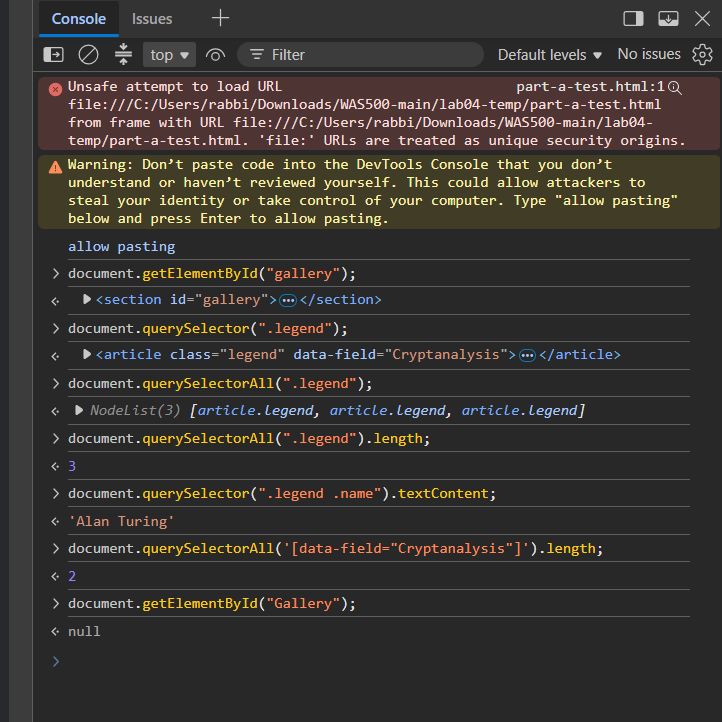
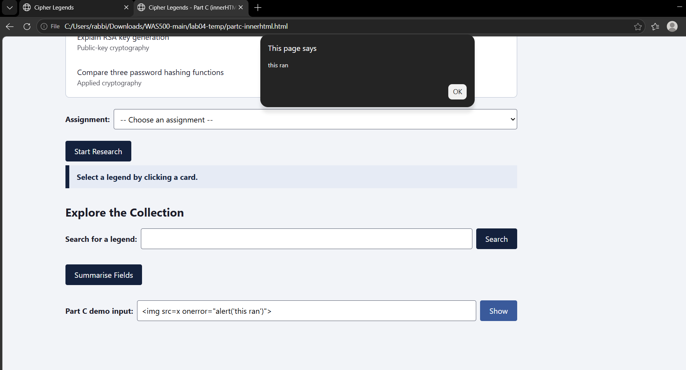
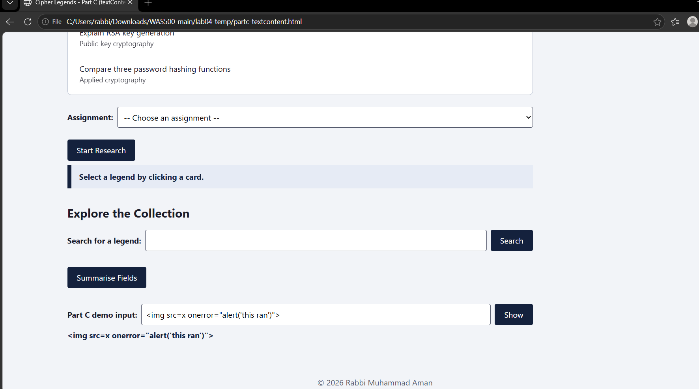
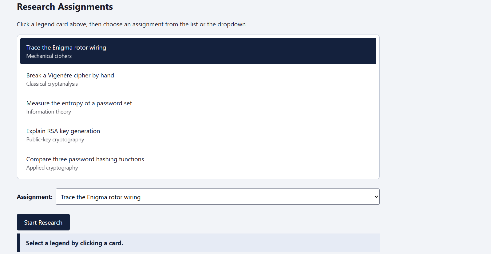
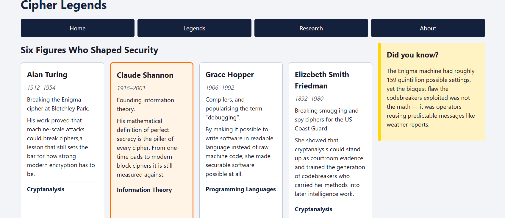
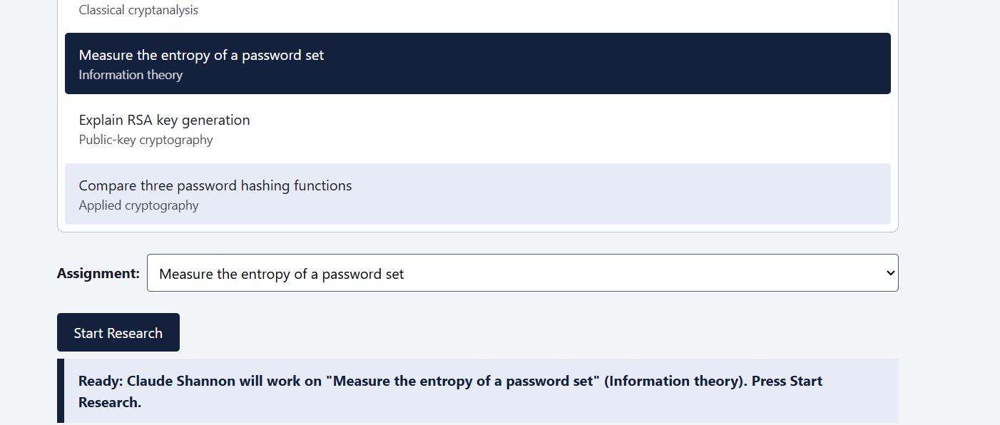
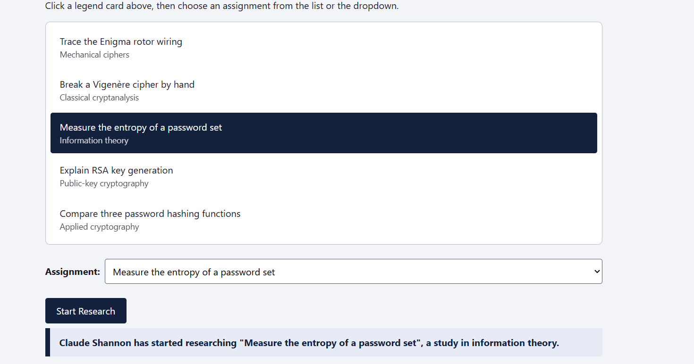

# Lab Submission Template
## Title: Lab 04 - Dynamic Page Updates with DOM and Events
- **Name**: Rabbi Muhammad Aman
- 
- **Date**: 2026-10-04
---
## Table of Contents
1. [Introduction](#introduction)
2. [Part A - Predict the Selection](#part-a---predict-the-selection)
3. [Part B - Research Assignments Panel](#part-b---research-assignments-panel)
4. [Part C - innerHTML and Why the Lecture Warned You](#part-c---innerhtml-and-why-the-lecture-warned-you)
5. [Debug and Repair](#debug-and-repair)
6. [Screenshots Deliverables](#screenshots-deliverables)
7. [Experience and Challenges](#experience-and-challenges)
---
## Introduction
There were three components in this lab. For part A, I made predictions about the output of DOM selection 
techniques, and then verified my results in the console. For Part B, I introduced a Research Assignments Panel
on the Cipher Legends website from Lab 03. The drop-down and list are created using an array in JavaScript,
which stay consistent, and the log of research is updated if there is any assignment or legend chosen.
For Part C, I created a page which executes injected script using `innerHTML`, and then found out that the 
`textContent` prevents it from executing. I corrected four bugs in a small script for highlighting, and kept 
the new file as `debug.js`.

---
## Part A - Predict the Selection

I wrote my predictions first. Then I built a test page with the given markup, ran each line in the
browser console (F12 → Console), and recorded the actual result. ✓ means the prediction matched.

| Line | My prediction (before running) | Actual result (console) | Match |
|---|---|---|---|
| `document.getElementById("gallery")` | A single element: the `<section id="gallery">` | `<section id="gallery">…</section>` | ✓ |
| `document.querySelector(".legend")` | A single element: only the **first** `.legend` article (Alan Turing) | `<article class="legend" data-field="Cryptanalysis">…</article>` (the Turing article) | ✓ |
| `document.querySelectorAll(".legend")` | A NodeList holding all 3 `.legend` articles | `NodeList(3) [article.legend, article.legend, article.legend]` | ✓ |
| `document.querySelectorAll(".legend").length` | The number `3` | `3` | ✓ |
| `document.querySelector(".legend .name").textContent` | The string `"Alan Turing"` (first `.name` inside a `.legend`) | `'Alan Turing'` | ✓ |
| `document.querySelectorAll('[data-field="Cryptanalysis"]').length` | The number `2` (Turing and Hopper) | `2` | ✓ |
| `document.getElementById("Gallery")` | `null`, because ids are case-sensitive and no element has the id `Gallery` | `null` | ✓ |



The red "Unsafe attempt to load URL" message at the top of the screenshot is not from my code. Chrome
shows it when a page is opened straight from a `file://` path, and it appeared before I ran any lines.

### 2.4 Required answers

**2.4.1 - `querySelector` vs `querySelectorAll`.**
The `querySelector` method returns the **first** matching element or `null`. The `querySelectorAll` method returns **all** the matching elements wrapped inside a NodeList, which will be empty if there are no matching elements. Single elements cannot be iterated over. If I use the code
`for (const x of document.querySelector(".legend"))`, I receive
`TypeError: ... is not iterable`, and the `.length` is `undefined`, so my `for` loop never executes.

**2.4.2 - `"Gallery"` with a capital G.**
It returned `null`. The `getElementById` method is **case-sensitive**. It expects to find an id which
matches exactly the string, hence `"Gallery"` and `"gallery"` are two different ids. It will not throw any
error if it cannot find anything. It simply returns `null` and the error comes later if I try to use it.

**2.4.3 - NodeList is not an array.**
`forEach()` operates on a NodeList, but `map()` and other methods (like `filter()` and `reduce()`) don't: I get the `TypeError: ... .map is not a function` message. However, to call these methods, I can use
`Array.from(document.querySelectorAll(".legend"))`
or `[...document.querySelectorAll(".legend")]`.

---
## Part B - Research Assignments Panel

### Setup (2.5-2.6)
I copied my `lab03` folder into `lab04`. The toggle, search, and summary code from Lab 03 is still at
the top of `script.js`, unchanged. The Lab 04 code is added below it.

### Building the panel from data (2.7-2.10)
`script.js` contains `const assignments`, which is an array of five objects with `id`, `title`, and `topic`.
In `index.html`, `<ul id="assignmentList">` and `<select id="assignmentSelect">` contain no elements at all.

One `for...of` loop over the array builds **both** controls in the same pass:
- an `<li>` tag created using `document.createElement("li")`. The `<li>` tag has its attribute set using
  `setAttribute("data-id",...)` to store assignment id and `setAttribute("tabindex","0")` for making it tabbable.
  It consists of two `<span>` tags containing title and topic respectively and `appendChild()` adds it to DOM.
- an `<option>` tag created using `document.createElement("option")` with `value = assignment.id`, then
  `appendChild()` is used to add it to select tag.

The text content is always added using `textContent` and `innerHTML` is never used. The only item that does not come from the array is a placeholder option: `-- Choose an assignment --` (its value is `""`). This option is also created by the JavaScript. **If an additional object is added to the array, it will be shown both in the list and in the drop-down menu without any other changes.** I verified this with a temporary copy of the page whose array had a sixth entry: the list showed 6 items, the dropdown showed 6 assignments, and clicking the new item selected it in the dropdown.

### Selection and synchronisation (2.11-2.13)

| # | Behaviour | How |
|---|---|---|
| a | Clicking a list item highlights it and selects the matching option | `selectAssignment(id)` adds the `selected` class to the `<li>` and sets `assignmentSelect.value = id` |
| b | Changing the dropdown highlights the matching item | The `change` listener calls the same `selectAssignment(event.target.value)` |
| c | Only one assignment highlighted | `selectAssignment` first removes `selected` from every `<li>`, then adds it to one |
| d | Clicking a card selects that legend | One listener on `#gallery` finds the card with `event.target.closest(".card")` |
| e | Only one legend selected | `selectLegend` removes `selected` from all cards, then adds it to the clicked one |

The process works the same way in both cases, so the list and the dropdown can’t get out of sync.
Highlighting is done using `classList.add` / `classList.remove`. The appearance of `.selected` is determined in
`styles.css` (orange borders on cards, dark backgrounds on list items). `element.style` isn’t used for highlighting.
Also, `aria-current="true"` is added using `setAttribute` to the selected element,
and is removed from other elements using `removeAttribute`.

The code contains **only one** `click` event listener on the `<ul>`, not one on each `<li>`.
The event bubbles up to the list from the element clicked (or from the `<span>` within the element).
With `event.target.closest("li")`, the clicked `<li>` can be found, and its `getAttribute("data-id")`
property shows which assignment it is. Clicking the padding of the list will give `null`.

### 2.14 Why one listener on the parent is better
As there is just one listener listening to `<ul>` element, the number of elements doesn’t matter for
the code at all: it could be either five or fifty elements; in both cases there will be just one
function and one listener in the memory. The most important thing about this code is that any new
elements that appear in the list later can operate without problems, because clicks from them will
also be caught by the same `<ul>` element. Having a listener in each `<li>` element would mean having
`addEventListener` call for every new element, otherwise this element won’t do anything upon clicking.

### Research log (2.15-2.18)
`<p id="researchLog" aria-live="polite">` and `<button id="startBtn">Start Research</button>` were
added under the dropdown.

| # | Condition | Log message |
|---|---|---|
| a | No legend selected | `Select a legend by clicking a card.` |
| b | No assignment selected | `Select a research assignment.` |
| c | Both selected | `Claude Shannon has started researching "Measure the entropy of a password set", a study in information theory.` |

The message is built by `getStatusMessage()`, which `updateLog()` calls on page load and after every
legend or assignment selection, so the log always shows the current state before the button is
pressed. When both are chosen it shows a "Ready: ... Press Start Research." line. `aria-live="polite"`
makes screen readers read the new text once the user is idle, without interrupting them.

### Keyboard access (2.19-2.20)
All the cards have `tabindex="0"` on HTML while the list items get it via JavaScript, so Tab key will navigate through all of them. The `keydown` event listeners on the gallery and the list items look for `event.key === "Enter"`, then they call `selectLegend`/`selectAssignment` functions similar to the click function. `event.preventDefault()` prevents Enter from doing any other work.

### Step 9 - Acceptance criteria

| # | Criterion | Result |
|---|---|---|
| a | List and dropdown empty in HTML, filled by JS | Pass |
| b | Sixth array entry updates both with no other change | Pass - tested with an extra entry |
| c | List and dropdown synchronised both ways | Pass |
| d | Exactly one assignment and one legend highlighted | Pass |
| e | Highlighting uses `classList` | Pass |
| f | Single delegated listener on the list | Pass |
| g | "No legend" and "no assignment" messages correct | Pass |
| h | Cards and list items reachable by Tab, activate with Enter | Pass |
| i | No console errors in normal use | Pass |
| j | Lab 03 toggle, search, summary still work | Pass - grid restores, `  tURiNg  ` finds Alan Turing, summary prints 2 / 1 / 1 / 2 |

---
## Part C - innerHTML and Why the Lecture Warned You

Here I employed a temporary version of my page, which included a text box, a **Show** button, and an empty `<div id="demoOutput">`. The code for this button handler consisted of just one line:
`demoOutput.innerHTML = demoInput.value;`

### 2.23 With `innerHTML`
I typed `` and pressed Show. An alert box saying
**"this ran"** popped up. The browser turned my text into a real `` element, the image `x` failed
to load, and its `onerror` attribute ran as JavaScript. That code was never written in my script.



### 2.24 With `textContent`
I altered the code to be `demoOutput.textContent = demoInput.value;` and entered the same input.
Nothing popped up as an alert. The text `` was displayed exactly as entered,
without an image being created.



### 2.25 Answers
**2.25.1** `innerHTML` parses the string into **HTML**, meaning that any tags within it will be turned into actual elements, along with any event handlers like `onerror`. `textContent`, however, assumes that the string is **plain text**, creating just one text node where `<` and `>` are simply symbols and cannot do anything.

**2.25.2** In case the assignment titles were obtained from a database where anyone can add something,
then a title such as `` could be saved. The result with `innerHTML`
would then be that all visitors to the page get the script to execute in their browsers. This could involve
reading out their information, modifying the page, or making requests on their behalf.
This is an example of stored XSS. With `createElement` and `textContent`, the result would just
be a strange looking string.

**2.25.3** Rule: Whatever text comes from the user input, the database, or anything other than my script
goes in with `textContent`, and elements are made using `createElement` / `appendChild`.
I would only consider using `innerHTML` if the text was a set string, written by me.

### 2.26 Cleanup
The temporary input, button, and `innerHTML` line were only in a separate demo copy. They are **not**
in the submitted `index.html`.

---
## Debug and Repair

### 2.28 Defect table

| # | Defect | Corrected line | How you would notice it |
|---|---|---|---|
| 1 | **Capitalisation (silent).** `classList.add("Selected")` adds a class called `Selected`, but the CSS rule and the `remove` call use `selected`. Class names are case-sensitive. | `clickedItem.classList.add("selected");` | No error at all. The item just never looks highlighted. In the Elements panel the `<li>` shows `class="Selected"`. |
| 2 | **Method not called.** `event.stopPropagation;` only reads the function and never runs it, so the click still bubbles. | `event.stopPropagation();` | No error. A listener on a parent element (e.g. `document`) still fires, which I can see with a `console.log` there. |
| 3 | **`innerHTML` used to read the item.** The lecture says to use `textContent` for text. `innerHTML` returns markup (for my items it logs the `<span>` tags), and it is the habit Part C showed to be unsafe. | `console.log("Selected: " + clickedItem.textContent);` | The console prints HTML tags such as `<span>Trace the Enigma...</span>` instead of plain text. |
| 4 | **Assumes `event.target` is an `<li>`.** Clicking the list's padding makes `event.target` the `<ul>`, and clicking the `<span>` inside an item makes it the span. The code then highlights or reads the wrong element, and any `<li>`-only code after it (for example `event.target.closest("li").getAttribute(...)`) throws `TypeError: Cannot read properties of null`. | `const clickedItem = event.target.closest("li");`<br>`if (clickedItem === null) { return; }` | Click in the gap between items. The whole list gets highlighted and the console logs all the list's markup (or a red `TypeError`). |

Corrected code (`debug.js`):

```javascript
const list = document.getElementById("assignmentList");

list.addEventListener("click", function (event) {
  const clickedItem = event.target.closest("li");
  if (clickedItem === null) {
    return;
  }

  const items = document.querySelectorAll("#assignmentList li");
  for (let i = 0; i < items.length; i++) {
    items[i].classList.remove("selected");
  }
  clickedItem.classList.add("selected");
  console.log("Selected: " + clickedItem.textContent);
  event.stopPropagation();
});
```

---
## Screenshots Deliverables

### 1. Populated list and dropdown (both built by JavaScript)
All five assignments in the list. Clicking "Trace the Enigma rotor wiring" selected the same title in
the dropdown. No legend was chosen yet, so the log shows the "no legend" message.



### 2. A selected legend
Claude Shannon's card is selected (orange border). The other cards are not highlighted.



### 3. Research log before starting
Shannon selected and "Measure the entropy of a password set" chosen. The list item and the dropdown
match, and the log already shows the "Ready" state before the button is pressed.



### 4. Research log after starting
After clicking **Start Research**, the log names the legend, the assignment title, and its topic.



### 5. Part C - `innerHTML` (code ran) and `textContent` (shown as text)


---
## Experience and Challenges
- **What did you learn?** Building the page content from the data array by using `createElement` and `appendChild` rather than hard coding the data in HTML was one of the things that I have learned. The use of `event target` and `closest()` for event bubbling which enables an event listener to be used for every child using one event listener was another thing that I learned. Switching of styles using `classList` was yet another thing that I have learned to do. In part C, I have learned that `innerHTML` is a choice of security; a single line was enough to execute code that I did not write.
- **What challenges did you face?** Keeping the list and the dropdown menu in synchronization became difficult in the beginning,
  since I had two different handlers, which modified only one element each. Clicking on the smaller text
  representing a topic in an item did not cause selection, as `event.target` was the `<span>`, and not the `<li>`.
  On smaller screens, the dropdown menu was wider than the screen width because of the assignment
  titles.
- **How did you solve them?** Moved the selection logic into a single `selectAssignment(id)` function, which both the list and the dropdown will now call, thus preventing them from having any inconsistencies. Used `event.target.closest("li")` to always pick out the item and immediately return when it is `null`. Added `min-width: 0` and `max-width: 100%` for the dropdown so that it can reduce in size within the flex row.