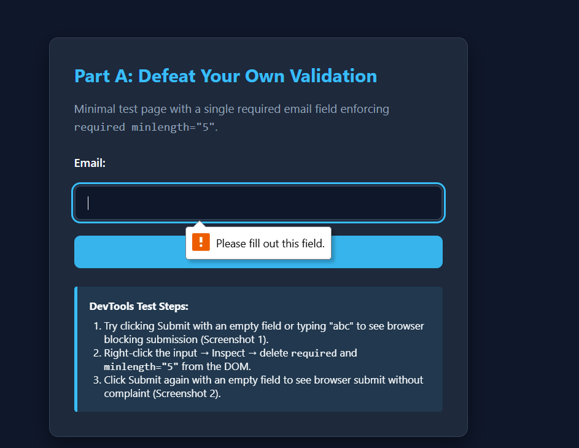
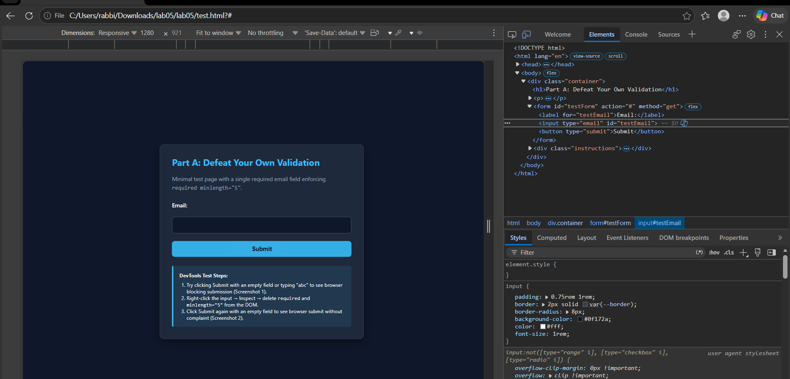
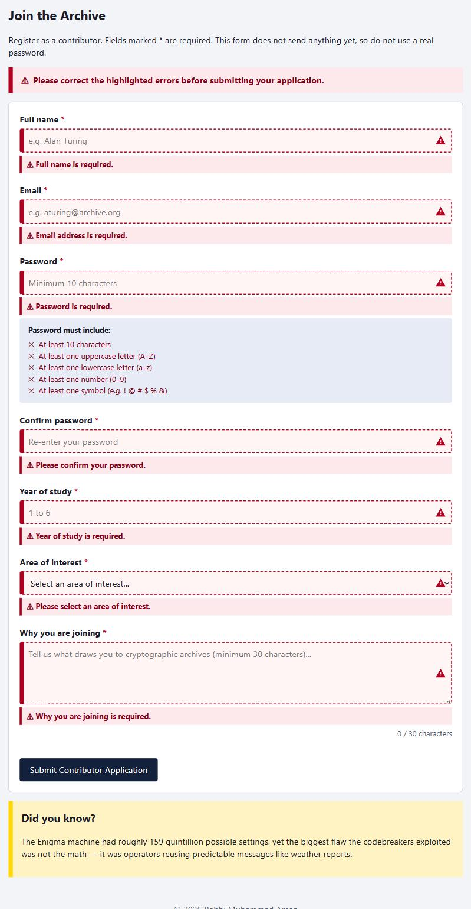
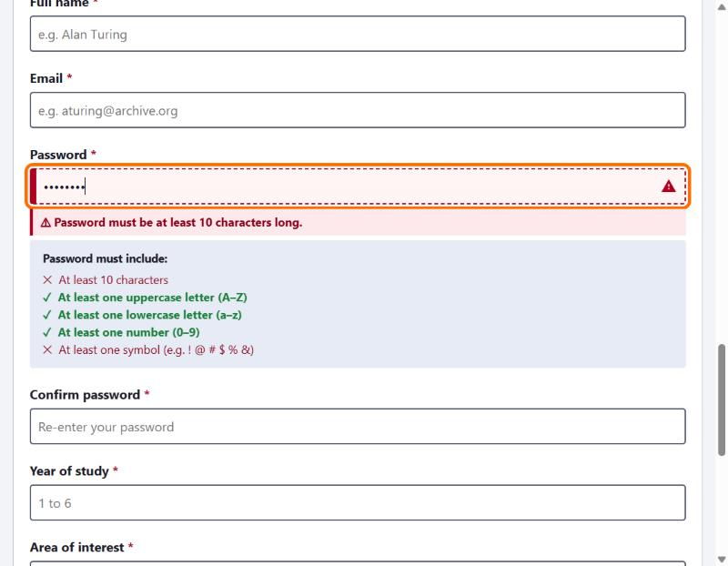
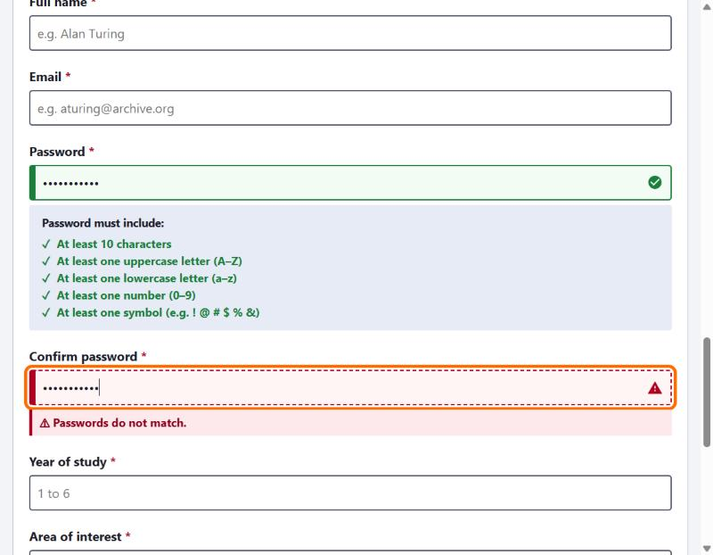
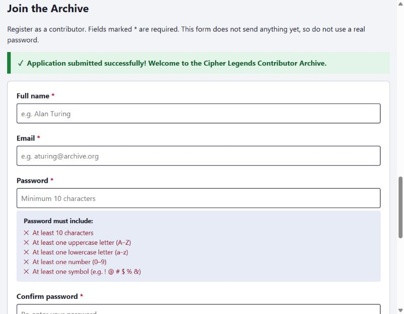

# Lab Submission Template
## Title: Lab 05 - Client-Side Validation and UX
- **Name**: Rabbi Muhammad Aman
- 
- **Date**: 2026-10-11

---

## Part A — Why Client-Side Validation Is Not Security

### 1. Step 1: Defeat Your Own Validation Experiment

A minimal test form was constructed in `test.html` containing a single email field configured with HTML5 validation constraints:

```html
<form id="testForm" action="#" method="get">
  <label for="testEmail">Email:</label>
  <input type="email" id="testEmail" required minlength="5" />
  <button type="submit">Submit</button>
</form>
```

#### Observations & Test Records:
- **Baseline Test (Step 2.2):**  
  Leaving the field empty or providing an incorrect string (such as "abc") will cause the browser's constraint validation engine to prevent the submit from happening by intercepting the event. The browser won't let you submit the form and instead will focus on the input and show the user a constraint validation message (such as "*Please fill out this field*" or "*Please include an '@' in the email address*").

  

- **DOM Manipulation via DevTools (Step 2.3 & 2.4):**  
  Opening Microsoft Edge DevTools (**F12** / **Inspect**), selecting the `<input id="testEmail">` element within the **Elements** panel, and deleting the `required` and `minlength="5"` attributes directly removes the validation constraints from the live DOM node in memory. When the submit button is clicked again with an empty field, the browser submits the form without any warning and the page reloads with `?` / `#` added to the URL. (A malformed value like `abc` is still blocked, because `type="email"` was left in place - deleting the attributes only removed the rules I deleted.)

  

---

### 2. Theoretical Analysis & Synthesis (Step 2.5)

#### 2.5.1. Where Client-Side Validation Rules Actually Live
Where the validation rules are specified in terms of HTML attributes such as required, minlength and pattern, they are shipped via the network in static HTML and interpreted into the DOM tree residing completely in memory of the client-side browser runtime environment. The ability to edit or remove these attributes from browser Developer Tools is trivially possible since the client machine belongs to the user and the user has complete control over the runtime memory and the DOM tree and execution of JavaScript code. This basic architectural fact makes it clear that client-side validation rules reside in an untrusted execution environment outside the trust boundary of the application.

#### 2.5.2. The True Purpose and Real Benefits of Client-Side Validation
Since client-side validation can be easily stripped down or even ignored by the use of scripting or API, client-side validation should be regarded solely as a **User Experience (UX) improvement tool** rather than a security measure. It provides two main benefits:
1. **Immediate and Near-Zero-Latency Response:** This will instruct cooperative end users directly in real-time as they input their data by letting them know of the formatting rules, typing mistakes, and avoiding user frustration without having to wait for an async network trip.
2. **Preservation of Bandwidth and Server Loads:** This will serve as a filter which will reject invalid inputs from normal users, thus preventing the waste of processing cycles, database hits, and cloud network bandwidth.

#### 2.5.3. Fundamental Server-Side Assumption for Lab 06
While implementing the backend server in Lab 06, the server **should always consider any received input to be entirely untrusted, unchecked, and possibly malicious** regardless of whether some validation has been done on the front-end. Since the requests may have been formed manually by tools such as `curl` and Postman or even modified during an actual browser session bypassing the front-end validation, the server should validate again the presence, type, format, length, and sanity of each parameter on its own.

---

## Part B — The Contributor Registration Form

### 1. Workspace Architecture
The complete workspace has been established under `lab05/` preserving the Cipher Legends historical archive:
- `index.html`: The Lab 04 page copied unchanged (legend gallery, Hide/Show Legends, Research Assignments panel, search and summary tools) with a new **Join the Archive** section (`<form id="joinForm">`) and a "Join" nav link.
- `styles.css`: Complete styling rules enforcing high contrast, accessible keyboard focus indicators, and distinct valid/invalid visual feedback not dependent on color alone.
- `script.js`: The Lab 04 script, followed by the Lab 05 validation code: pure validation functions, one display function, live password requirement tracking, and submission handling.
- `test.html`: Minimal isolated test page for Part A DevTools demonstration.

---

### 2. Form Field Specification & HTML5 Validation Attributes (Step 4)

| Field Label | Input ID | HTML5 Attributes Implemented | Custom Validation Rules Enforced |
| :--- | :--- | :--- | :--- |
| **Full name** | `fullName` | `required`, `minlength="2"`, `autocomplete="name"` | Non-empty trimmed string ≥ 2 characters |
| **Email** | `email` | `type="email"`, `required`, `autocomplete="email"` | Non-empty RFC-compliant email pattern |
| **Password** | `password` | `type="password"`, `required`, `minlength="10"`, `pattern="(?=.*[a-z])(?=.*[A-Z])(?=.*[0-9])(?=.*[^A-Za-z0-9\s]).{10,}"` | Length ≥ 10, uppercase, lowercase, number, symbol |
| **Confirm password** | `confirmPassword` | `type="password"`, `required` | Strict value equivalence with `#password` |
| **Year of study** | `yearOfStudy` | `type="number"`, `min="1"`, `max="6"`, `step="1"`, `required` | Whole number from 1 to 6 (both included) |
| **Area of interest** | `interest` | `<select required>` | Selection of 1 of 4 approved archive specializations |
| **Why you are joining** | `motivation` | `<textarea required minlength="30">` | Non-empty statement with at least 30 trimmed characters |

---

### 3. Step 4.12: The Two Rules HTML5 Cannot Fully Express

**Answer (Step 2.12):**  
The two validations that are not possible using only the HTML5 attributes are as follows:
1. **Password Matches Confirm Password:** Validation of HTML5 occurs on a single individual DOM element basis only; there is no way to create cross-field dependency or equality checks between two separate inputs using HTML5.
2. **Multi-Rule Feedback Messages for Passwords:** Even though it is possible to include multiple regular expressions in one HTML5 pattern attribute, validation via HTML5 considers the whole expression in a pass or fail status only; it is impossible for HTML5 to keep track of progress in all four character classes (upper case, lower case, number, special characters).

---

### 4. Visual Validity States Without Relying on Colour Alone (Step 2.11 & Criterion g)

Invalid and valid states in `styles.css` are styled with the `:invalid` and `:valid` pseudo-classes (applied once the field has content, using `:not(:placeholder-shown)` so an untouched form is not covered in errors), plus the `.is-invalid` / `.is-valid` classes and `[aria-invalid="true"]` set by `script.js`. Colour is never the only signal:
- **Border style:** Invalid fields get a **dashed** border with a thick left bar; valid fields get a **solid** border with a thick left bar.
- **Icons:** Invalid fields show a warning triangle inside the right edge of the field; valid fields show a check-mark circle.
- **Textual Badges & Prefixes:** Error messages placed beneath the field explicitly include a bold warning icon prefix (`⚠ `) and clear instructions.
- **Password Checklist Markers:** Each of the five password criteria dynamically swaps between a red cross icon (`✕`) and a green checkmark (`✓`) while transitioning font weights from normal to bold.

---

### 5. Custom JavaScript Validation Architecture (Step 5)

#### 5.1. Decoupling Logic from the DOM (Step 2.13)
All seven validation routines (`validateFullName`, `validateEmail`, `validatePassword`, `validateConfirmPassword`, `validateYearOfStudy`, `validateInterest`, `validateMotivation`) are pure functions. They accept raw value strings and return an empty string (`""`) for valid input or a descriptive, actionable error message string for invalid input without reading or modifying the DOM.

#### 5.2. Centralized Error Presentation Function (Step 2.14)
A single display function, `displayFieldError(fieldElement, errorMessage)`, handles all DOM state modifications:
- Finds the corresponding error element using the field's `aria-describedby` attribute.
- Sets the error text and toggles element visibility.
- Toggles `aria-invalid="true"` or removes the attribute cleanly.
- Applies `.is-invalid` or `.is-valid` styling classes.

#### 5.3. Real-Time Feedback & Cross-Field Reactivity (Step 2.15)
- **Live Input Validation:** Each field validates on the `'input'` event so users receive instantaneous feedback as they type.
- **Live Password Progress Tracker:** An interactive checklist updates on each keystroke, verifying length (≥10), uppercase, lowercase, numbers, and symbols independently.
- **Cross-Field Password Re-check:** When the user modifies `#password`, the confirmation field `#confirmPassword` re-runs its equality evaluation automatically to prevent stale confirmation states.

---

### 6. Accessibility & Keyboard Operability (Step 6)

1. **Screen Reader Association (`aria-describedby`):** Every input element is explicitly linked to its respective error container ID (e.g., `aria-describedby="fullNameError"`), ensuring assistive technologies announce error descriptions when reading the control.
2. **State Announcement (`aria-invalid`):** Inputs dynamically receive `aria-invalid="true"` when failing validation, informing screen readers of the element's error state.
3. **Live Form Status Announcements (`aria-live="polite"`):** The global status element `<div id="formStatus" role="status" aria-live="polite">` alerts non-sighted users to overall submission outcomes without interrupting active speech.
4. **Full Keyboard Focus Management:** All inputs, the select, the textarea and the button use the same `:focus-visible` outline as the rest of the site (`outline: 4px solid #ff6d00; outline-offset: 3px`). The whole form can be completed with Tab, typing, arrow keys in the dropdown, and Enter to submit. Upon submitting an invalid form, focus is programmatically shifted to the first invalid field (`firstInvalidElement.focus()`).

---

## Part C — Debug the Validation

### 1. Defect Identification and Resolution Table (Step 2.22 & 2.23)

| # | The Defect | Corrected Line | Revealing Test Input | Why It Breaks / Behavior Before Fix |
| :---: | :--- | :--- | :--- | :--- |
| **1** | Missing `return` keyword before number check message | `return "Password needs a number";` | `"Abcdefghij"` | The statement `("Password needs a number");` evaluates as an unused string expression and execution falls through, allowing passwords without numbers to bypass check. |
| **2** | Inverted symbol regex condition | `if (!value.match(/[!@#$%^&*]/)) {` | `"ValidPass1!"` *(valid rejected)* or `"ValidPass12"` *(invalid accepted)* | `value.match(...)` returns truthy when a symbol is present, causing the function to reject passwords that have symbols and accept passwords that lack them. |
| **3** | Inconsistent return type (`true` vs error string) | `return "";` | `"ValidPass12"` | Because the symbol check is inverted, this reaches `return true`. The caller's `if (error)` treats `true` as an error and the span shows the text `true`. |
| **4** | Error message never cleared upon becoming valid | `if (error) { pwError.textContent = error; } else { pwError.textContent = ""; }` | Type `"short"`, then change it to `"Enigma1940!"` (with defects 1-3 fixed) | The caller has no `else` branch, so the old message "Password must be at least 10 characters" stays on screen after the password becomes valid. In the original code this is hidden by defect 3, because the result is never falsy. |
| **5** | Omitted 'Required' empty-field check | `if (!value \|\| value.trim() === "") { return "Password is required"; }` | `""` *(empty string)* | An empty field failed with `"Password must be at least 10 characters"` rather than reporting that the mandatory field was left blank. |

The verified correction has been saved to `lab05/debug.js`.

---

### 2. Return-Type Inconsistency Analysis (Step 2.25)

**Answer (Step 2.25):**  
In JavaScript, both a non-empty string and the boolean `true` are truthy values. Consequently, when the original function returned `true` upon validating successfully, the caller's conditional statement `if (error)` evaluated to `true`, mistakenly treating a successful validation as an error and inserting `"true"` into the DOM. A consistent return type is to return an empty string (`""`) for valid input (which evaluates to falsy) and a non-empty descriptive error string for invalid input.

---

## Screenshots Deliverables

### Empty form submitted - every error shown at once, focus on Full name


### Live password feedback while typing


### Mismatched confirm password


### Successful submission - success message and cleared form


---

## Experience and Challenges

### What did you learn?
This experiment really helped me understand the difference between user experience improvements on the client side and actual server side security limits. Seeing how easily one could remove all the HTML5 validation through DevTools showed me that client side validation was just something to make the life of cooperative users easier and not a hurdle for the adversaries. Moreover, doing accessibility in form validation showed how important it was to associate error messages with input fields through `aria-describedby`, toggle `aria-invalid`, and use non-color visual cues.
### What challenges did you face?
1. **Decoupling Validation Logic from DOM Interactions:** Creating purely functional validation operations that would return simple strings without manipulating the class and text properties of elements took careful planning.
2. **Cross-Field Password Interaction Handling:** Making sure that the confirmation field will validate its content in case of editing *both* the password field and/or confirmation field without getting into an infinite loop.
3. **Validity States Multisensory Representation:** Writing CSS code that would convey validity states without depending only on color.

### How did you solve them?
1. **Single Display Function Pattern:** Defined `displayFieldError(fieldElement, errorMessage)` as the only function that handles all updates to DOM class names, error elements, and ARIA attributes according to the results of the verdict strings generated by the pure functions.
2. **Two-Way Input Event Handlers:** Used `input` event handlers for `#password` and `#confirmPassword` to call `validateConfirmPassword` when there is a change in either of them after user activity.
3. **Redundant Visual Representation:** Used dashed borders for invalid, solid for valid fields; icons within the field (triangle and tick); and textual glyphs as a representation of validity that would be easily recognized in any color vision situation.
