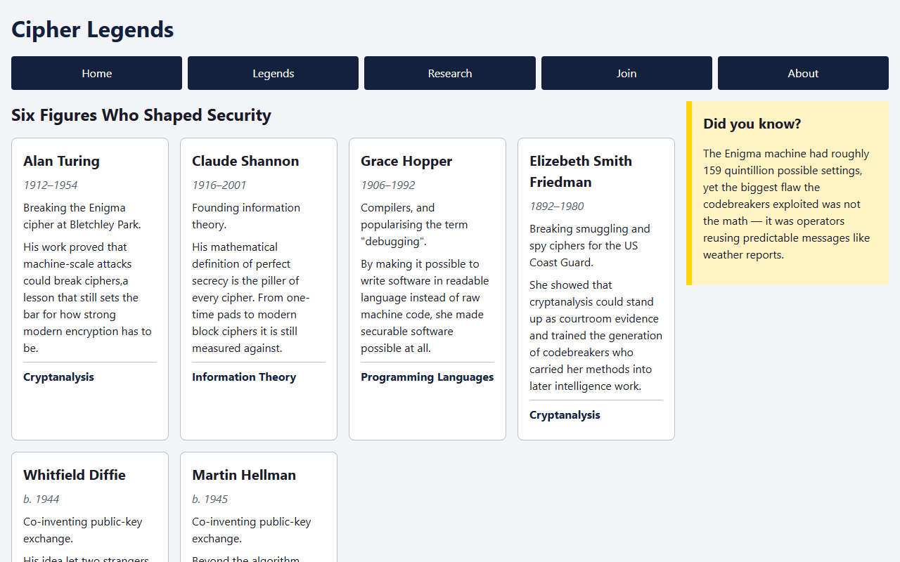
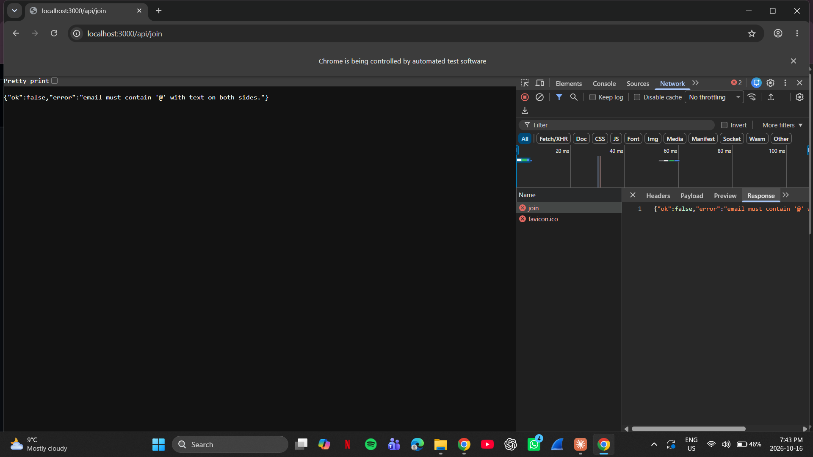
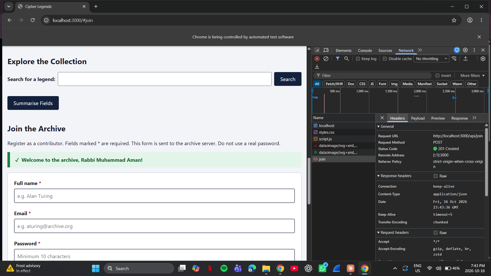
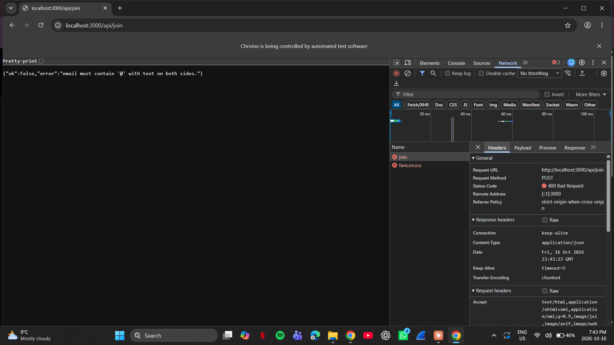
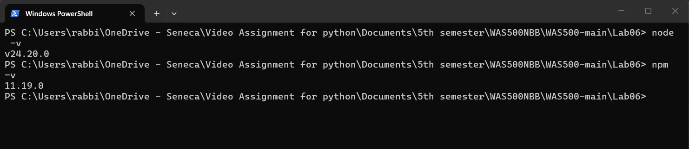
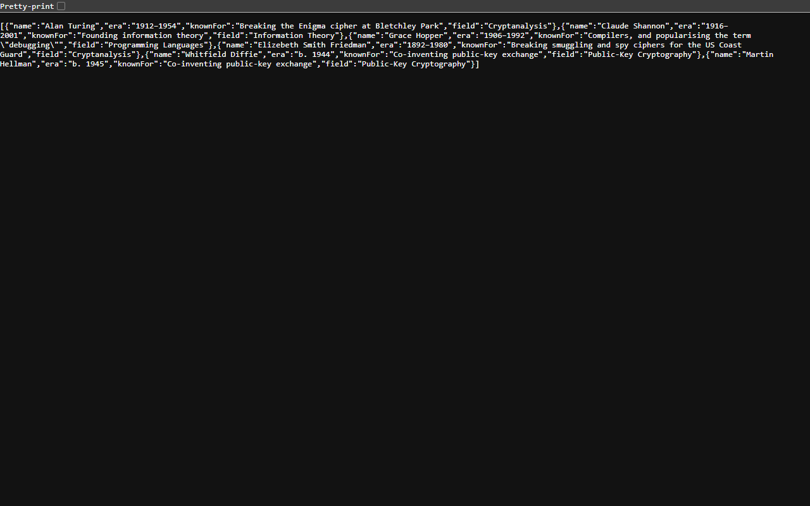
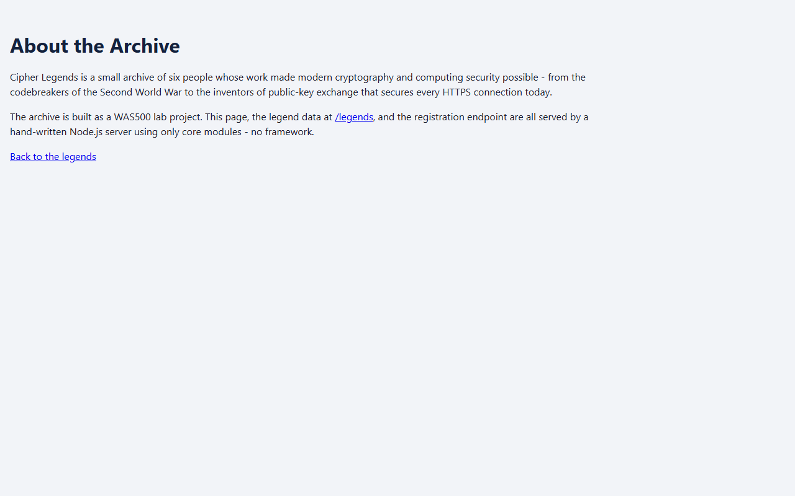
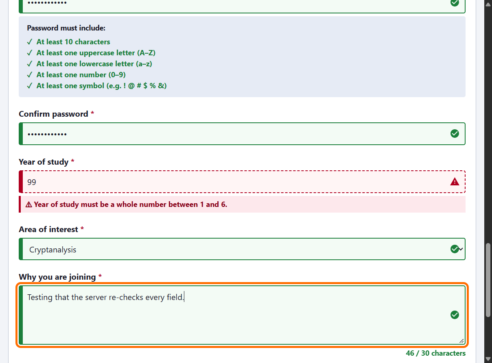
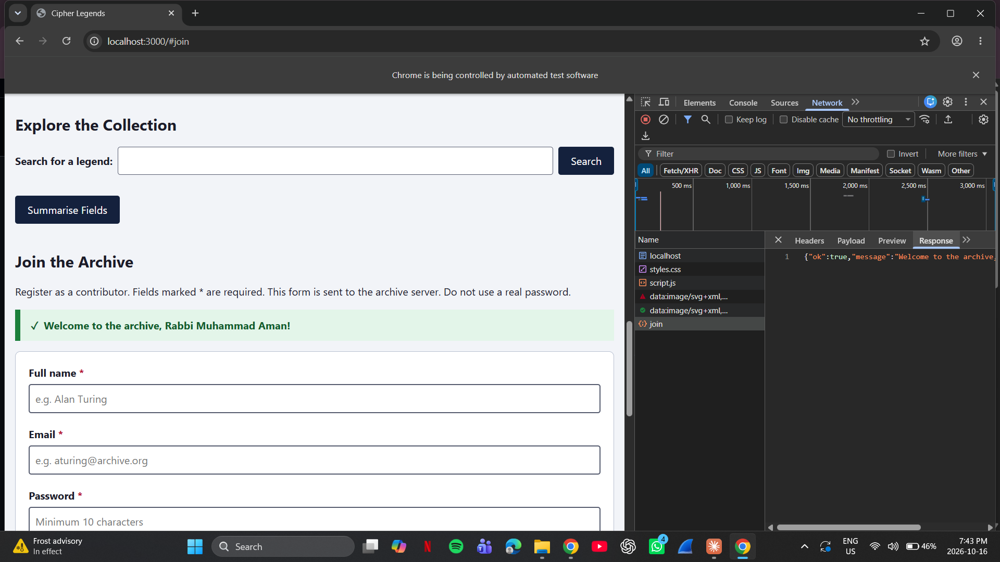
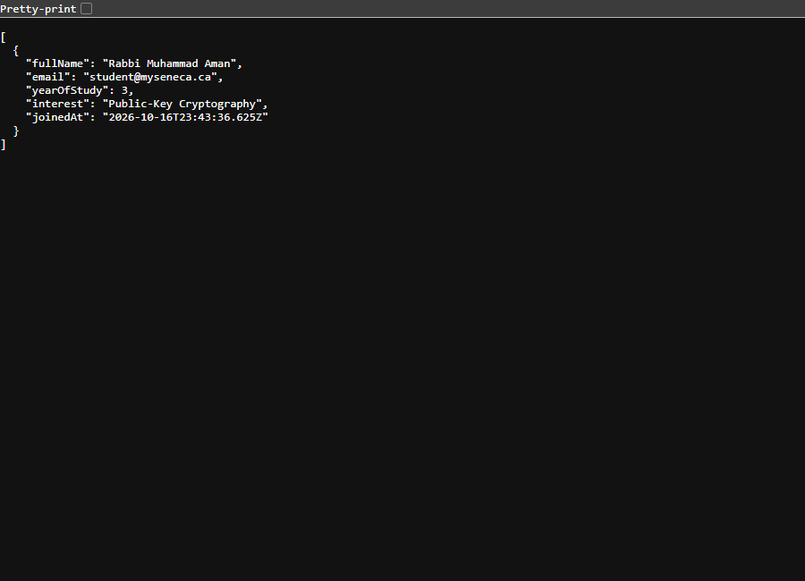

# Lab 06 - Node.js Server, File I/O, and Routing
- **Author**: Rabbi Muhammad Aman
- **Date**: 2026-10-16

## What I built (summary)

A **Node.js web server written from scratch**, using only core modules (`http`, `fs`, `path`, `url`, `querystring`) and **no Express**. It serves the Cipher Legends site and enforces validation **on the server**, where users can't tamper with it.

| Area | What I did |
|---|---|
| **Blocking vs non-blocking I/O** | Made a server freeze with `fs.readFileSync`, then fixed it with async `fs.readFile`: **5,137 ms vs 7 ms** for the same `/slow` request |
| **Routing** | Hand-written routes for `/`, `/about`, `/legends` (JSON) and `/api/join`, plus static files with correct MIME types and a proper 404 page |
| **Server-side validation** | `/api/join` accepts URL-encoded or JSON bodies and re-validates every field. It returns **400** with a specific error, or **201** on success |
| **Security proof** | Bypassed my own client-side validation in DevTools (`form.submit()`); the server still rejected the bad data, which shows **the server is the real gate** |
| **Privacy by design** | Passwords are validated but **never stored**. Only safe fields are saved to `data/contributors.json` |
| **Debugging** | Found and fixed 5 defects in a buggy route handler (`debug.js`), including returning `200` with `ok: false`, which hides errors from clients and logs |

### Run it
```bash
cd lab06
node server.js            # then open http://localhost:3000
node blocking-demo.js     # the Part A blocking vs non-blocking demo
```
Requires Node.js 18+; no `npm install` needed.

| Served by Node | Server rejects tampered input (400) | Accepted (201) |
|---|---|---|
|  |  |  |

The full lab report follows below.

---
## Table of Contents
1. [Introduction](#introduction)
2. [Part A - Blocking vs Non-Blocking](#part-a---blocking-vs-non-blocking)
3. [Part B - The Cipher Legends Server](#part-b---the-cipher-legends-server)
4. [Step 8 - Proving the Server-Side Validation Works](#step-8---proving-the-server-side-validation-works)
5. [Part C - Debug the Server](#part-c---debug-the-server)
6. [Acceptance Criteria](#acceptance-criteria)
7. [Screenshots Deliverables](#screenshots-deliverables)
8. [Experience and Challenges](#experience-and-challenges)
---
## Introduction
Cipher Legends went from being a browser tab opened to a server page served by my own Node server using nothing but Node core libraries (`http`, `fs`, `path`, `url`, `querystring`) without any frameworks in this lab. In Part A, I forced a Node server hang using `fs.readFileSync` and then improved the code with `fs.readFile`, and understood what "non-blocking" means. In Part B, I coded `server.js`: it serves the Lab 05 site from `public/` with proper MIME types; it manually routes `/`, `/about`, `/legends` and `/api/join`; it accepts registration forms URL-encoded or as JSON; it validates every input once more on the server side; it doesn't save user passwords; it saves accepted contributors in `data/contributors.json`. In Step 8, I removed HTML5 validation from the form in the browser and showed that the server refuses to accept the wrong data sending back `400`. In Part C, I located and corrected five defects of a buggy `/api/join` route handler and saved the correction as `debug.js`.
### Folder structure
```
lab06/
├─ public/
│  ├─ index.html
│  ├─ styles.css
│  └─ script.js
├─ data/
│  └─ contributors.json
├─ images/            (screenshots for this report)
├─ server.js
├─ blocking-demo.js
├─ debug.js
├─ .gitignore         (keeps big.txt out of the repo)
└─ README.md        (this report)
```

---
## Part A - Blocking vs Non-Blocking

### Deliverable 1: Node and npm versions (2.2)
```bash
# Command executed
node -v
npm -v
```
**Output**:
```bash
v24.20.0
11.19.0
```

### Deliverable 2: The demo server (2.3-2.4)
`blocking-demo.js` has two routes. `/fast` answers `fast` immediately. `/slow` reads the large file and answers with its length. I generated the file with:

```bash
node -e "require('fs').writeFileSync('big.txt','x'.repeat(80_000_000))"
```

One read of an 80 MB file only took around 200 ms on my laptop, which was too quick to see properly, so `/slow` reads the file 25 times in a row. I kept both versions in one file so they can be compared without editing code: `node blocking-demo.js sync` runs the `fs.readFileSync` version and `node blocking-demo.js` runs the `fs.readFile` (callback) version.

```javascript
// Version 1 - blocks the event loop
for (let i = 0; i < 25; i++) {
  length = fs.readFileSync(BIG_FILE, "utf8").length;
}

// Version 2 - hands the read to libuv and returns immediately
fs.readFile(BIG_FILE, "utf8", (err, data) => {
  if (err) { /* 500 */ return; }
  ...
});
```

### Deliverable 3: What happened (2.5-2.8)
I sent `/slow` first and `/fast` 100 ms later, while `/slow` was still working, and timed both.

**Synchronous version (`fs.readFileSync`):**
```bash
/fast sent at 154 ms, finished at 5291 ms -> waited 5137 ms, body "fast"
/slow finished at 5288 ms, body "slow (sync): 80000000 characters"
# server console
/slow (sync) answered in 5238 ms
/fast answered in 0 ms
```
`/fast` sat in the loading state for over **5 seconds** and only came back a few milliseconds *after* `/slow` finished. The server's own log says `/fast` took 0 ms. It did no work at all; it just could not start until `/slow` let go.

**Asynchronous version (`fs.readFile`):**
```bash
/fast sent at 140 ms, finished at 147 ms -> waited 7 ms, body "fast"
/slow finished at 2108 ms, body "slow (async): 80000000 characters"
# server console
/fast answered in 2 ms
/slow (async) answered in 2071 ms
```
This time `/fast` answered in **7 ms**, while `/slow` was still reading. The two requests no longer affected each other.

### Deliverable 4: Answers (2.9)
**2.9.1** The processing of the `/fast` request was delayed because Node executes all the JavaScript code I wrote in one thread, and `readFileSync()` locks the thread until the entire file is read. While the `/fast` request reached the server at the right moment, the event loop that should pass the request to my callback was blocked by the `/slow` request handler.

**2.9.2** What is actually blocked is the **Node process**, in particular, the single-threaded JavaScript thread and event loop. The computer is not blocked, since other programs were still running and the operating system continued to accept incoming connections, and the request is not slow either, because the request did nothing slowly.

**2.9.3** If there were a hundred people using this application, then each of their requests would wait in queue after each execution of `readFileSync`: if one of those hundred was trying to access the slow route, the site would become blocked for the other 99 people regardless of how small their request was, and as long as there is continuous traffic, eventually all the requests will timeout. Using `fs.readFile`, the reading operation runs asynchronously and thus allows the server to keep working.

### Clean-up (2.10)
I deleted `big.txt` after testing and added it to `.gitignore`, so the 80 MB file can never be committed. `blocking-demo.js` is committed.

---
## Part B - The Cipher Legends Server

### Workspace (2.11-2.12)
I moved my Lab 05 `index.html`, `styles.css` and `script.js` files into `lab06/public/`. **None of the asset paths had to be modified.** `index.html` makes use of the relative path `href="styles.css"` and `src="script.js"`, and because the HTML file is loaded from `/`, it makes a request for `/styles.css` and `/script.js`. These are handled by my static handler using `public/styles.css` and `public/script.js`. This was confirmed, rather than assumed, by testing and observing that they both serve `200` with the correct content type (see test log below).

The only modifications made in the Lab 05 codebase are as follows:
- `index.html`: The form element has an attribute of `action="/api/join" method="POST"`, **About** navigation menu is changed to redirect to the new `/about` route, and the note under the header does not say that the form “does not send anything”, along with `<link rel="icon" href="data:,">` in order to prevent favicon logging.
- `script.js`: when there is a successful submission, instead of just displaying a message, the event listener now submits the form to `/api/join` using `fetch()` and displays the message received from the server ("Welcome to the archive, <name>!") or error from the server.

### Serving the site and MIME types (2.13-2.17)
The server listens on port **3000**. `GET /` reads `public/index.html` with `fs.readFile` (async) and responds `200` with `Content-Type: text/html`.

The MIME types are **one lookup object**, and the extension comes from `path.extname()`. Supporting a new file type means adding one line here:

```javascript
const MIME_TYPES = {
  ".html": "text/html",
  ".css": "text/css",
  ".js": "application/javascript",
  ".png": "image/png",
  ".jpg": "image/jpeg",
  ".jpeg": "image/jpeg",
  ".svg": "image/svg+xml",
};
const contentType = MIME_TYPES[path.extname(filePath).toLowerCase()];
```

**404 vs 500.** These are different situations and the code checks `err.code` to tell them apart:

```javascript
fs.readFile(filePath, (err, data) => {
  if (err) {
    if (err.code === "ENOENT" || err.code === "EISDIR") {  // not there -> the client asked for something that doesn't exist
      sendNotFound(res, pathname);                          // 404
      return;
    }
    console.error(`Error reading ${filePath}:`, err);        // exists but unreadable -> our fault
    sendHtml(res, 500, "<h1>500 - Internal Server Error</h1>...");
    return;
  }
  res.writeHead(200, { "Content-Type": contentType });
  res.end(data);
});
```

I tested the `500` path for real. I created `public/locked.css` and used `icacls` to deny my own account read permission, so the file **exists** but cannot be read:

```bash
$ curl http://localhost:3000/locked.css   (file exists, read permission denied)
<h1>500 - Internal Server Error</h1><p>The file could not be read.</p>
500 text/html

$ curl -s -o /dev/null -w "%{http_code} %{content_type}\n" http://localhost:3000/missing.css
404 text/html
```

I also block path traversal: any path that resolves outside `public/` (for example `/../server.js`) gets a `404`, so nobody can download my server source.

### Manual routing (2.18-2.19)
Routing is done by checking `pathname` and `req.method`:

| Route | Method | Response |
|---|---|---|
| `/` | GET | `public/index.html`, `200 text/html` |
| `/about` | GET | An HTML string I wrote describing the archive, `200 text/html` |
| `/legends` | GET | JSON array of the six legends, `200 application/json` |
| `/api/join` | POST | Registration handler (below) |
| static files with an extension | GET | Served from `public/` via the MIME table |
| anything else | any | `404` with an HTML message |

`/legends` is served as data, not a page: Chrome shows it in its raw JSON viewer with a "Pretty-print" checkbox (screenshot 3), and the response header is `Content-Type: application/json`.

### Handling the registration POST (2.20-2.27)
**Collecting the body (2.21).** The body is **accumulated** with `+=` because a large POST arrives in several chunks. I also cap it at 1 MB so nobody can send me an endless body.

```javascript
let body = "";
req.on("data", (chunk) => { body += chunk; ... });
req.on("end", () => { ... });
```

**Both content types (2.22).** I read the `Content-Type` header (ignoring anything after `;`, like `charset=utf-8`):
- `application/x-www-form-urlencoded` → `querystring.parse(body)`
- `application/json` → `JSON.parse(body)` inside `try`/`catch`; malformed JSON → `400`
- anything else → `415 Unsupported Media Type`

**Server-side validation (2.23).** `validateRegistration(data)` re-checks every rule and returns a message naming the field and the reason:

| Field | Server rule | Example error |
|---|---|---|
| `fullName` | Present, ≥ 2 characters after `trim()` | `fullName must be at least 2 characters after trimming.` |
| `email` | Present, contains `@` with text before and after it | `email must contain '@' with text on both sides.` |
| `yearOfStudy` | Present, numeric, 1 to 6 | `yearOfStudy must be between 1 and 6 (received 99).` |
| `interest` | Present and one of the four permitted values | `interest must be one of: Cryptanalysis, Information Theory, Public-Key Cryptography, Applied Cryptography.` |

**The password is not stored (2.24).** The record written to disk is built from the allowed fields only, so the password is accepted and then thrown away. The comment in `server.js`:

```javascript
// The password is deliberately NOT stored. Even if it arrives in the body we
// only build the record from the four allowed fields, so it is discarded here.
// Writing a plaintext password to disk means anyone who can read this file (or
// a backup of it, or a git commit of it) learns every user's password - and
// people reuse passwords. Real systems store only a slow salted hash (Week 12).
```

**Persistence (2.25).** `saveContributor()` runs `fs.mkdir(DATA_DIR, { recursive: true })` (creates `data/` if missing), then reads `data/contributors.json`. If the read fails with `ENOENT`, the list starts as `[]`. Then it appends `{ fullName, email, yearOfStudy, interest, joinedAt }` and writes it back with `JSON.stringify(list, null, 2)`.

**Responses (2.26-2.27).** Every outcome from `/api/join` is JSON:

| Outcome | Status | Body |
|---|---|---|
| Success | `201` | `{"ok":true,"message":"Welcome to the archive, Ada Lovelace!"}` |
| Validation failure | `400` | `{"ok":false,"error":"yearOfStudy must be between 1 and 6 (received 99)."}` |
| Malformed JSON | `400` | `{"ok":false,"error":"Request body is not valid JSON."}` |
| Unsupported content type | `415` | `{"ok":false,"error":"Unsupported Content-Type 'text/plain'. Use application/x-www-form-urlencoded or application/json."}` |
| Unexpected failure | `500` | `{"ok":false,"error":"Server error"}` |

### Error handling (2.28-2.30)
- All the calls to `fs` functions (`readFile`, `mkdir`, `writeFile`) use an error-first callback and there is a check for `err` before processing the data.
- There is a `try`/`catch` block around the calls to `JSON.parse` both for request body and when reading `contributors.json` in order to prevent errors from bad data.
- All errors are reported using `console.error` but the program continues running. The last defense is the `try`/`catch` around the router and `process.on("uncaughtException")`.

To test the `500` path for saving, I temporarily replaced `data/contributors.json` with a **folder** of the same name. The server logged the error and answered `500`, and the next request still worked:

```bash
$ curl -X POST -H 'Content-Type: application/json' --data '{"fullName":"Test User","email":"t@x.y","yearOfStudy":1,"interest":"Cryptanalysis"}' http://localhost:3000/api/join
{"ok":false,"error":"Server error"}
500

$ curl -s -o /dev/null -w "%{http_code}\n" http://localhost:3000/legends
200
# server console
Failed to save contributor: [Error: EISDIR: illegal operation on a directory, read] { code: 'EISDIR', ... }
```

### Deliverable 5: Full test run against `server.js`
```bash
$ curl -s -o /dev/null -w "%{http_code} %{content_type}\n" http://localhost:3000/
200 text/html
$ curl -s -o /dev/null -w "%{http_code} %{content_type}\n" http://localhost:3000/styles.css
200 text/css
$ curl -s -o /dev/null -w "%{http_code} %{content_type}\n" http://localhost:3000/script.js
200 application/javascript
$ curl -s -w "\n%{http_code} %{content_type}\n" http://localhost:3000/about | tail -1
200 text/html
$ curl -s -w "\n%{http_code} %{content_type}\n" http://localhost:3000/legends | cut -c1-120
[{"name":"Alan Turing","era":"1912–1954","knownFor":"Breaking the Enigma cipher at Bletchley Park","field":"Cryptan
200 application/json
$ curl -s -w "\n%{http_code} %{content_type}\n" http://localhost:3000/nowhere
...<h1>404 - Not Found</h1><p>Nothing in the archive lives at <code>/nowhere</code>.</p>...
404 text/html
$ curl -s -o /dev/null -w "%{http_code} %{content_type}\n" http://localhost:3000/missing.css
404 text/html
$ curl -s -o /dev/null -w "%{http_code}\n" --path-as-is http://localhost:3000/../server.js
404

# valid, URL-encoded (password included in the request)
$ curl -X POST -H 'Content-Type: application/x-www-form-urlencoded' --data 'fullName=Ada+Lovelace&email=ada%40example.com&password=Secret%21Pass99&confirmPassword=Secret%21Pass99&yearOfStudy=3&interest=Cryptanalysis&motivation=...' http://localhost:3000/api/join
{"ok":true,"message":"Welcome to the archive, Ada Lovelace!"}
201
# valid, JSON
$ curl -X POST -H 'Content-Type: application/json' --data '{"fullName":"Claude Shannon","email":"cs@bell.example","password":"Another#Pass1","yearOfStudy":5,"interest":"Information Theory"}' http://localhost:3000/api/join
{"ok":true,"message":"Welcome to the archive, Claude Shannon!"}
201

# each validation rule
$ ... --data 'fullName=A&email=a%40b.c&yearOfStudy=2&interest=Cryptanalysis'
{"ok":false,"error":"fullName must be at least 2 characters after trimming."}
400
$ ... --data 'fullName=Eve+Hacker&email=not-an-email&yearOfStudy=2&interest=Cryptanalysis'
{"ok":false,"error":"email must contain '@' with text on both sides."}
400
$ ... --data 'fullName=Eve+Hacker&email=eve%40example.com&yearOfStudy=99&interest=Cryptanalysis'
{"ok":false,"error":"yearOfStudy must be between 1 and 6 (received 99)."}
400
$ ... --data 'fullName=Eve+Hacker&email=eve%40example.com&yearOfStudy=two&interest=Cryptanalysis'
{"ok":false,"error":"yearOfStudy must be numeric."}
400
$ ... --data 'fullName=Eve+Hacker&email=eve%40example.com&yearOfStudy=2&interest=Hacking'
{"ok":false,"error":"interest must be one of: Cryptanalysis, Information Theory, Public-Key Cryptography, Applied Cryptography."}
400

# malformed JSON, then wrong content type
$ curl -X POST -H 'Content-Type: application/json' --data '{"fullName": "Broken", ' http://localhost:3000/api/join
{"ok":false,"error":"Request body is not valid JSON."}
400
$ curl -X POST -H 'Content-Type: text/plain' --data 'hello' http://localhost:3000/api/join
{"ok":false,"error":"Unsupported Content-Type 'text/plain'. Use application/x-www-form-urlencoded or application/json."}
415

# server still alive after all of that
$ curl -s -o /dev/null -w "%{http_code}\n" http://localhost:3000/
200

# no password anywhere in the stored file
$ grep -ci "pass" data/contributors.json
0

# delete the file, submit again -> it is recreated
$ rm data/contributors.json
$ curl -X POST -H 'Content-Type: application/json' --data '{"fullName":"Grace Hopper","email":"grace@navy.example","password":"Cobol#1959xx","yearOfStudy":"4","interest":"Applied Cryptography"}' http://localhost:3000/api/join
{"ok":true,"message":"Welcome to the archive, Grace Hopper!"}
201
$ cat data/contributors.json
[
  {
    "fullName": "Grace Hopper",
    "email": "grace@navy.example",
    "yearOfStudy": 4,
    "interest": "Applied Cryptography",
    "joinedAt": "2026-10-16T23:34:29.137Z"
  }
]
```
The server console logged `Malformed JSON received: Expected double-quoted property name in JSON at position 23` and kept running.

---
## Step 8 - Proving the Server-Side Validation Works

### What I did (2.31-2.32)
1. Started `node server.js` and opened `http://localhost:3000/#join` with DevTools on the **Network** tab.
2. Stripped the validation off every field: removed `required`, `minlength`, `min`, `max` and `pattern`, and changed `type="email"` / `type="number"` to `type="text"`. This is the same thing I did by hand in the Elements panel in Lab 05.
3. Filled the form with an invalid email `not-an-email` and a `yearOfStudy` of `99`.
4. My Lab 05 JavaScript still flagged the year (screenshot 6a), but that is also client-side code. I bypassed it by calling `document.getElementById("joinForm").submit()` from the console. `form.submit()` skips both the browser's constraint validation and the `submit` event listener, so the browser sent the POST to `/api/join` without complaint.

### What came back (2.33)
```
POST http://localhost:3000/api/join
Status Code: 400 Bad Request
Content-Type: application/json

{"ok":false,"error":"email must contain '@' with text on both sides."}
```
The browser let the bad data through; the server did not. It stops at the first rule that fails, which is the email. When I fixed only the email and sent `yearOfStudy=99` again, the server answered `400` with `yearOfStudy must be between 1 and 6 (received 99).` (see the test log above). Nothing was written to `contributors.json` for either request.

### Screenshots (2.34)
Network tab, **Headers**: `POST /api/join`, `Status Code: 400 Bad Request`, `Content-Type: application/json`:



Network tab, **Response**: the JSON body naming the failing field:


### Answer (2.35)
In Lab 05 Part A, deleting `required` and `minlength` in DevTools let the form submit, and nothing was there to stop it. This time the same trick still beat the browser (and even my own JavaScript), but the request then reached code I control and the user does not: the server re-checked the data and rejected it with a `400` that names the field. The server is the only place this check can be enforced, because everything in the browser (the HTML, the JavaScript and the request itself) is on the user's machine and can be edited or skipped, while the server code never leaves my machine.

---
## Part C - Debug the Server

### Deliverable 6: Defect table (2.36-2.37)
I ran the original handler and sent it one request per defect. All four requests that should have been handled gracefully **crashed the whole process** instead.

| # | Defect | Corrected line | Request that reveals it |
|---|---|---|---|
| 1 | **Body overwritten, not accumulated.** `body = chunk` keeps only the last chunk, so a large submission loses everything before it. | `body += chunk;` | A ~200 KB JSON body (a long `motivation`) arrives in several chunks. The original only kept the tail `"mmmm..."` and crashed with `SyntaxError: Unexpected token 'm', "mmmmmmmmmm"... is not valid JSON`. Fixed: `201` and the full 200 000-character value was saved. |
| 2 | **Unguarded `JSON.parse(body)`** throws on malformed input and kills the process. | `try { data = JSON.parse(body); } catch (err) { res.writeHead(400, ...); res.end(...); return; }` | `POST /api/join` with body `{bad json`. Original: `SyntaxError: Expected property name or '}' in JSON at position 1` and **process crashed**. Fixed: `400 {"ok":false,"error":"Body is not valid JSON"}`. |
| 3 | **Failure reported as success.** A missing email is sent with status `200`. | `res.writeHead(400, { "Content-Type": "application/json" });` | `{"fullName":"No Email"}`. Original: `HTTP/1.1 200 OK` even though the body says `ok:false`. Fixed: `400`. |
| 4 | **Missing `return`** after the rejection, so execution continues into the save path: the bad record would be saved and `res.end()` called a second time. | `return;` straight after `res.end(...)` in the `if (!data.email)` block | The same `{"fullName":"No Email"}` request. After sending the `200`, the original went on into `fs.readFile` and crashed (see #5) instead of stopping. Fixed: the handler stops after one `400` and saves nothing. |
| 5 | **`err` never checked** in the `fs.readFile` callback. When the file is missing, `file` is `undefined` and `JSON.parse(file)` throws. | `if (err) { if (err.code !== "ENOENT") { /* 500 */ return; } list = []; } else { list = JSON.parse(file); }` | A valid `{"fullName":"Ada","email":"ada@x.y"}` with **no** `data/contributors.json` on disk. Original: `SyntaxError: "undefined" is not valid JSON` and **process crashed**. Fixed: `201` and the file is created. |

I also gave `fs.writeFile` a callback that checks its own `err`, and the success response now uses `201` with a JSON content type.

### Deliverable 7: Test output, original vs fixed
```bash
########## ORIGINAL (buggy) handler ##########
--- test: malformed   body: {bad json
[PROCESS CRASHED]
SyntaxError: Expected property name or '}' in JSON at position 1 (line 1 column 2)

--- test: noemail   body: {"fullName":"No Email"}
HTTP/1.1 200 OK
[PROCESS CRASHED]
SyntaxError: "undefined" is not valid JSON

--- test: nofile   body: {"fullName":"Ada","email":"ada@x.y"}
[PROCESS CRASHED]
SyntaxError: "undefined" is not valid JSON

--- test: large body (~200 KB, arrives in several chunks)
[PROCESS CRASHED]
SyntaxError: Unexpected token 'm', "mmmmmmmmmm"... is not valid JSON

########## FIXED debug.js ##########
--- body: {bad json
{"ok":false,"error":"Body is not valid JSON"}  -> 400
--- body: {"fullName":"No Email"}
{"ok":false,"error":"Email required"}  -> 400
--- body: {"fullName":"Ada","email":"ada@x.y"}
{"ok":true}  -> 201
--- large body
{"ok":true}  -> 201
saved records: 2 | big motivation length: 200000
[debug.js still running]
```

### Deliverable 8: `debug.js` (2.38)
The corrected handler is in `lab06/debug.js`. It is wrapped in a small `http` server on port 3002 so it can be run and tested on its own (`node debug.js`).

---
## Acceptance Criteria

| # | Criterion | Result |
|---|---|---|
| a | `node server.js` starts on port 3000 with no errors | Pass: `Cipher Legends server running at http://localhost:3000`, no warnings (I replaced the deprecated `url.parse()` with `new url.URL()`) |
| b | Homepage, stylesheet and script load from `public/` | Pass: `200 text/html`, `200 text/css`, `200 application/javascript` |
| c | `/about` returns HTML; `/legends` returns JSON with correct content type | Pass: `text/html` / `application/json` |
| d | Unknown path → 404; missing static file → 404, not 500 | Pass: `/nowhere` 404, `/missing.css` 404; unreadable file 500 |
| e | MIME types from a lookup object | Pass: `MIME_TYPES[path.extname(...)]` |
| f | Valid submission → 201 and appended to `contributors.json` | Pass: URL-encoded and JSON both 201 and appended |
| g | Invalid submission → 400 naming the field | Pass: all four fields tested |
| h | Malformed JSON → 400 and server keeps running | Pass |
| i | Deleting `contributors.json` and submitting again recreates it | Pass |
| j | No password value in `contributors.json` | Pass: `grep -ci pass` → `0` |
| k | Server survives every test without exiting | Pass: the same process answered all of the tests above |

---
## Screenshots Deliverables

### 1. `node -v` and `npm -v`


### 2. Homepage served from Node (`http://localhost:3000/`)


### 3. `/legends` JSON output


### 4. `/about` HTML route


### 5. 404 for an unknown path


### 6a. Form with HTML5 validation stripped, invalid data entered


### 6b. 400 response in the Network tab (headers and JSON body)


### 7. Successful 201 submission
The form was submitted normally with valid data. The page shows the server's message, and the Network tab shows `POST /api/join`, `201 Created`, `application/json`.




### 8. Resulting `data/contributors.json`
Only the five allowed fields are stored, and there is no password.



---
## Experience and Challenges
### Reflection on Completing the Lab
- **What did you learn?** Understanding what "non-blocking" actually meant came when it did not work: a single readFileSync call which performed absolutely nothing waited more than five seconds due to the single-threadedness of Node. The lack of Express forced me to write the server and made me realize what the framework usually obscures: reading the body in pieces, supporting two content types, selecting an appropriate status code, Content-Type header, and translating URL to the file path. Above all else, Step 8 completed the idea suggested in Lab 05: the client can be tricked into sending any content and therefore, the requirements become valid only on the server side where the user cannot access them. Additionally, I found out that the status code is part of the answer itself, not just extra information. 200 with ok: false (Part C defect 3) is a lie that will be believed by both clients and log files.

- **Challenges Faced**: Node was not installed, and the initial installation attempt was aborted at the Windows administrator prompt. In Part A, the reading of the 80 MB file took place too quickly for the hang up to be observed. In regard to 404 vs. 500, it is easy to test for a non-existent file, but it is more difficult to test for a file that exists but cannot be read. Step 8 was insufficient by itself since my own Lab 05 JavaScript prevented the form submission from completing. In the end, defects 4 and 5 in Part C conceal each other, as the lack of a `return` is only obvious once the cause of the crash is known.
- **How You Overcame Challenges**: I installed again and confirmed the prompt, confirming `node -v`/`npm -v`. In part A, I made the program to read the file 25 times for `/slow`, which was quite evident (5137 ms vs 7 ms). In order to make sure that the 500 status code works, I denied myself the read access using `icacls` on a test file and changed the path of `contributors.json` into a folder. In order to defeat my own client-side JavaScript in step 8, I used `form.submit()` on the console, bypassing the browser validation as well as the submit function. This proves that the server is the gate. For Part C, I used the original handler and made requests per bug and observed their behavior before and after the fix, which was recorded in the "request that reveals it" column.
