# Lab 08 - MongoDB and Data Persistence
- **Author**: Rabbi Muhammad Aman
- **Date**: 2026-11-16

## What I built (summary)

The Cipher Archive moved from JSON files to **MongoDB**: the data model was designed first, then I worked against the database directly in `mongosh`, then built the **Mongoose model** Lab 09 will use and proved its validation rejects bad data.

| Area | What I did |
|---|---|
| **Data modelling** | Chose embed vs reference for each relationship: legend details embedded, unbounded **annotations referenced** in their own collection, contributors referenced by `ObjectId` |
| **Shell CRUD** | One `insertMany` for six legends, seven queries (filter, **projection**, sort, limit, regex, count), `updateOne` vs `updateMany`, delete and re-insert by `_id` |
| **`_id`** | Showed that `ObjectId` is generated by the client and carries its own creation timestamp |
| **Mongoose schema** | `required`, `trim`, `minlength`, `enum`, defaults, a **unique index** on `name`, and `strict: "throw"` to reject unknown fields |
| **Validation evidence** | Four invalid saves all rejected: three by Mongoose in Node (`ValidationError`), the duplicate by the **MongoDB server** (`E11000`) |
| **Security angle** | The shell accepts any shape, so schema rules only protect code that goes through the model. Database constraints, API validation and the schema are separate layers, and the connection string stays in `.env` |

### Run it
```bash
cd lab08
npm install
cp .env.example .env      # then set MONGO_URI=mongodb://127.0.0.1:27017/cipherarchive
npm run seed              # clears legends and inserts the six through the model
npm run validate          # four deliberately invalid saves, all rejected
```
Requires Node.js 18+ and a local MongoDB server (Community Server or Atlas).

| Shell queries | Compass: six documents | All four invalid saves rejected |
|---|---|---|
| 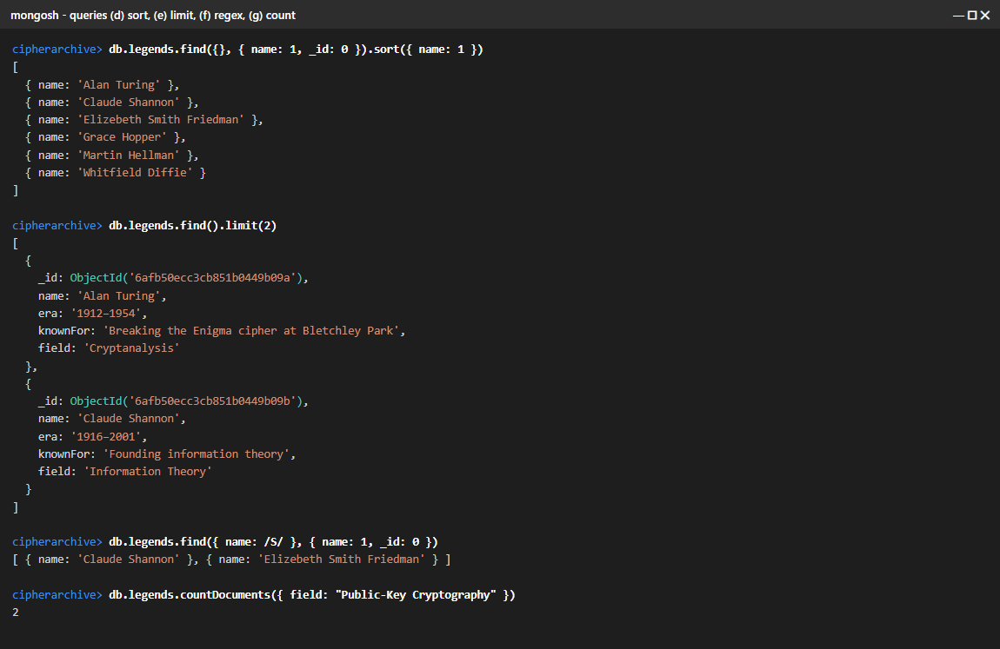 | 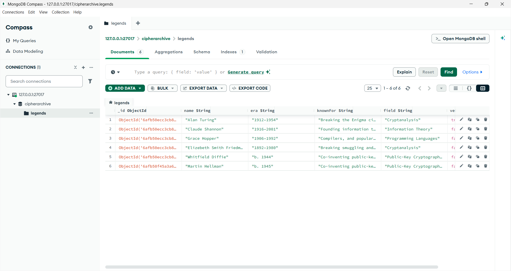 | 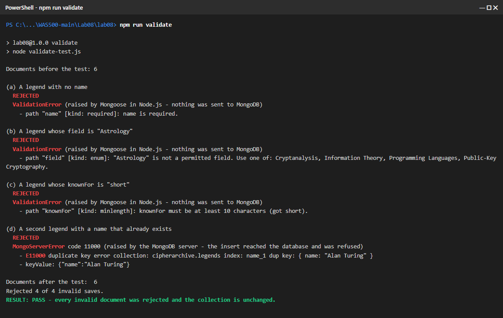 |

The full lab report follows below.

---
## Table of Contents
1. [Introduction](#introduction)
2. [Part A - Model the Data First](#part-a---model-the-data-first)
3. [Part B - The Mongo Shell](#part-b---the-mongo-shell)
4. [Part C - The Mongoose Schema](#part-c---the-mongoose-schema)
5. [Screenshots Deliverables](#screenshots-deliverables)
6. [Experience and Challenges](#experience-and-challenges)
---
## Introduction
In this lab, I move the Cipher Archive from JSON to MongoDB. In Part A, I created the data design without coding; I compared the document data model to the relational data model, made my decision on how to represent each relationship with either embedding or referencing, and ended up with the document design of a **legend** and an **annotation**. In Part B, I installed MongoDB Community Server 9.0.4 (as a Windows service), `mongosh` 2.14.1 and Compass, and coded against the `cipherarchive` database using the shell commands: one `insertMany` for the six Lab 02 legends, seven queries (filter, projection, sort, limit, regex, count), and five update/delete commands. In Part C, I implemented the Mongoose `Legend` model to be used in Lab 09, `seed.js` script that seeds the collection through the Mongoose model, and a `validate-test.js` script that demonstrates four types of invalid documents.

### Folder structure
```
lab08/
├─ models/
│  └─ legend.model.js     (Mongoose schema + model for a legend)
├─ images/                (screenshots for this report)
├─ .env                   (MONGO_URI=... - NOT committed)
├─ .env.example           (MONGO_URI=  - committed, no value)
├─ .gitignore             (node_modules/ and .env)
├─ package.json           (scripts: npm run seed, npm run validate)
├─ package-lock.json
├─ seed.js                (clears legends and inserts six through the model)
├─ validate-test.js       (four deliberately invalid saves)
└─ report08.md
```
---
## Part A - Model the Data First

### Answer 2.1 - Relational vs document model
In the relational database scenario, I will have `legends`, `contributors` and `annotations` tables, and reconstruct legends along with their annotations through joins between tables. On the other hand, MongoDB keeps related information in one document where it is being read; most of the "joins" will be avoided through embedding (legend's fields will be inside the legend document itself), and the rest through referencing: each annotation will contain `ObjectId` of its legend and contributor, and the application will do a separate query or use `$lookup` aggregation operation (left outer join in MongoDB) if both of them are needed. `populate()` from Mongoose will do a separate query automatically. The thing that the relational world gives me and MongoDB does not have is **referential integrity enforced by the database**: since there is a foreign key constraint, you cannot create an annotation without corresponding `contributorId` existing and cannot delete contributors who have annotations. In MongoDB, `ObjectId` is just a field and there is no guarantee it will point to an existing document, therefore referential integrity constraint must be implemented on the application side. Finally, the relational database always enforces **fixed schema of each row**, while MongoDB allows any form of documents unless additional validation is added (see part C).
### Deliverable 2.2 - Embed or reference
| # | Relationship | Decision | Justification |
| --- | --- | --- | --- |
| a | A legend's `era`, `knownFor`, and `field` | **Embed** (plain fields on the legend) | They belong to exactly one legend, are small, never change independently and are always shown with the legend, so a separate collection would only add a lookup. |
| b | The annotations written about a legend (potentially hundreds, growing over time) | **Reference** (separate `annotations` collection with a `legendId`) | An unbounded, growing array would keep making the legend document bigger (toward the 16 MB limit), slow every legend read, and make it hard to page through or query annotations on their own. |
| c | The contributor who wrote an annotation | **Reference** (`contributorId` on the annotation) | A contributor exists independently, writes many annotations and can change their name or email, so storing one copy and pointing at it avoids updating hundreds of embedded copies. |
| d | A contributor's single `interest` value | **Embed** (plain string field on the contributor) | It is a single value from a small fixed list that only describes that contributor and is never needed on its own. |

### Answer 2.3 - The general rule
Rule for me: **Embed what belongs to the parent and read along with it; reference what belongs to everyone, what is not bounded or is independent in itself.** Data should be embedded if it is small and bounded (single value or fixed list), does not change frequently or if it changes, changes along with the parent, and is read very often along with the parent — then you get everything in a single read operation and the update is atomic. Data should be referenced if it can grow indefinitely (annotations), belongs to multiple parents where any change to it will affect many documents (name of a contributor), changes frequently on its own, or needs to be accessed separately (list of all annotations made by a single contributor, paging of annotations).

### Deliverable 2.4 - Document shapes
**Legend** (`legends` collection) — implemented in `models/legend.model.js`:
```json
{
  "_id": { "$oid": "6afb519cd66588f786f64887" },
  "name": "Alan Turing",
  "era": "1912–1954",
  "knownFor": "Breaking the Enigma cipher at Bletchley Park",
  "field": "Cryptanalysis",
  "verified": false,
  "addedAt": { "$date": "2026-11-16T18:55:24.740Z" }
}
```
`field` is one of `Cryptanalysis`, `Information Theory`, `Programming Languages`, `Public-Key Cryptography`. There is deliberately **no** `annotations` array on the legend.

**Annotation** (`annotations` collection) — referenced from both sides:
```json
{
  "_id": { "$oid": "6afb52a1c3cb851b0449b0b1" },
  "legendId": { "$oid": "6afb519cd66588f786f64887" },
  "contributorId": { "$oid": "6afb52a1c3cb851b0449b0a0" },
  "text": "Turing's bombe design reused cribs from predictable weather reports.",
  "createdAt": { "$date": "2026-11-16T19:10:00.000Z" },
  "updatedAt": { "$date": "2026-11-16T19:10:00.000Z" }
}
```
For reference, the **contributor** document I will move to MongoDB in Lab 09 keeps the Lab 07 fields with `interest` embedded: `{ _id, fullName, email, yearOfStudy, interest, joinedAt }`. To show a legend with its notes: `db.annotations.find({ legendId: <id> }).sort({ createdAt: -1 })` (with an index on `legendId`), or `$lookup` / `populate()` when the contributor's name is needed too.

---
## Part B - The Mongo Shell

### Deliverable 2.5-2.8 - Install and verify
I installed MongoDB Community Server, `mongosh` and Compass using `winget` (packages `MongoDB.Server`, `MongoDB.Shell`, `MongoDB.Compass.Full`) with the default settings so `mongod` runs as the `MongoDB` Windows service (`sc query MongoDB` -> `STATE: 4 RUNNING`).

```bash
# Command executed
mongod --version
```
**Output**:
```bash
db version v9.0.4
Build Info: {
    "version": "9.0.4",
    "gitVersion": "64ade602b836c9adeffba7fa038c887ffab56196",
    "modules": [],
    "allocator": "tcmalloc-gperf",
    "javascriptEngine": "mozjs-wasm",
    "environment": {
        "distmod": "windows",
        "distarch": "amd64",
        "target_arch": "amd64"
    }
}
```

```bash
# Command executed
mongosh
```
**Output**:
```bash
Current Mongosh Log ID:	6afb51aa8092388e381cc29b
Connecting to:		mongodb://127.0.0.1:27017/?directConnection=true&serverSelectionTimeoutMS=2000&appName=mongosh+2.14.1
Using MongoDB:		9.0.4
Using Mongosh:		2.14.1

For mongosh info see: https://www.mongodb.com/docs/mongodb-shell/

------
   The server generated these startup warnings when booting
   2026-11-16T13:50:42.525-05:00: Access control is not enabled for the database. Read and write access to data and configuration is unrestricted
------
test> db.runCommand({ connectionStatus: 1 }).ok
1
```
`mongosh` connected to `mongodb://127.0.0.1:27017`, the default port **27017** (2.8). The startup warning only says access control is off, which is the default for a local development install; it is not reachable from other machines because the default config binds to `127.0.0.1` only.

### Deliverable 2.9-2.12 - Create the database and collection, insert with one `insertMany`
```bash
# Command executed
test> use cipherarchive
```
**Output**:
```bash
switched to db cipherarchive
```
```bash
# Command executed
cipherarchive> db.createCollection("legends")
cipherarchive> show collections
```
**Output**:
```bash
{ ok: 1 }
legends
```
```javascript
// Command executed - all six legends in ONE call, using the shape from 2.4
db.legends.insertMany([
  { name: "Alan Turing", era: "1912–1954", knownFor: "Breaking the Enigma cipher at Bletchley Park", field: "Cryptanalysis" },
  { name: "Claude Shannon", era: "1916–2001", knownFor: "Founding information theory", field: "Information Theory" },
  { name: "Grace Hopper", era: "1906–1992", knownFor: "Compilers, and popularising the term \"debugging\"", field: "Programming Languages" },
  { name: "Elizebeth Smith Friedman", era: "1892–1980", knownFor: "Breaking smuggling and spy ciphers for the US Coast Guard", field: "Cryptanalysis" },
  { name: "Whitfield Diffie", era: "b. 1944", knownFor: "Co-inventing public-key exchange", field: "Public-Key Cryptography" },
  { name: "Martin Hellman", era: "b. 1945", knownFor: "Co-inventing public-key exchange", field: "Public-Key Cryptography" }
])
```
**Output**:
```bash
{
  acknowledged: true,
  insertedIds: {
    '0': ObjectId('6afb50ecc3cb851b0449b09a'),
    '1': ObjectId('6afb50ecc3cb851b0449b09b'),
    '2': ObjectId('6afb50ecc3cb851b0449b09c'),
    '3': ObjectId('6afb50ecc3cb851b0449b09d'),
    '4': ObjectId('6afb50ecc3cb851b0449b09e'),
    '5': ObjectId('6afb50ecc3cb851b0449b09f')
  }
}
```
(`verified` and `addedAt` are not included here on purpose - the shell has no schema and no defaults; `verified` is added in 2.16, and `addedAt` appears once the model inserts the documents in Part C.)

### Deliverable 2.13 - Examining `_id`
```bash
# Command executed
db.legends.findOne({ name: "Alan Turing" })
const t = db.legends.findOne({ name: "Alan Turing" }); print(t._id instanceof ObjectId, typeof t._id, t._id.getTimestamp())
```
**Output**:
```bash
{
  _id: ObjectId('6afb50ecc3cb851b0449b09a'),
  name: 'Alan Turing',
  era: '1912–1954',
  knownFor: 'Breaking the Enigma cipher at Bletchley Park',
  field: 'Cryptanalysis'
}
true object ISODate('2026-11-16T18:52:28.000Z')
```
**Answer 2.13:** I didn’t provide an `_id`, so the **`mongosh` driver created one on the client before insertion** (the server would create one even if the client didn't). This is an **ObjectId**, a 12-byte BSON type: 4 bytes of a timestamp of creation (`getTimestamp()` returns the timestamp of my insert), 5 bytes of a randomly generated value specific to the machine or process, and 3 bytes of an increasing counter – thus the 6 different ids differ from each other only in their last byte. The ids are not 1, 2, 3, because having a counter would require a single place to declare "next number" which would render the insert operation inefficient and impossible to scale with multiple clients or shards; an ObjectId could be independently created everywhere.

### Deliverable 2.14 - Queries
**a. Every legend in the collection**
```bash
# Command executed
db.legends.find()
```
**Output**:
```bash
[
  {
    _id: ObjectId('6afb50ecc3cb851b0449b09a'),
    name: 'Alan Turing',
    era: '1912–1954',
    knownFor: 'Breaking the Enigma cipher at Bletchley Park',
    field: 'Cryptanalysis'
  },
  {
    _id: ObjectId('6afb50ecc3cb851b0449b09b'),
    name: 'Claude Shannon',
    era: '1916–2001',
    knownFor: 'Founding information theory',
    field: 'Information Theory'
  },
  {
    _id: ObjectId('6afb50ecc3cb851b0449b09c'),
    name: 'Grace Hopper',
    era: '1906–1992',
    knownFor: 'Compilers, and popularising the term "debugging"',
    field: 'Programming Languages'
  },
  {
    _id: ObjectId('6afb50ecc3cb851b0449b09d'),
    name: 'Elizebeth Smith Friedman',
    era: '1892–1980',
    knownFor: 'Breaking smuggling and spy ciphers for the US Coast Guard',
    field: 'Cryptanalysis'
  },
  {
    _id: ObjectId('6afb50ecc3cb851b0449b09e'),
    name: 'Whitfield Diffie',
    era: 'b. 1944',
    knownFor: 'Co-inventing public-key exchange',
    field: 'Public-Key Cryptography'
  },
  {
    _id: ObjectId('6afb50ecc3cb851b0449b09f'),
    name: 'Martin Hellman',
    era: 'b. 1945',
    knownFor: 'Co-inventing public-key exchange',
    field: 'Public-Key Cryptography'
  }
]
```

**b. Only legends whose `field` is `Cryptanalysis`**
```bash
# Command executed
db.legends.find({ field: "Cryptanalysis" })
```
**Output**:
```bash
[
  {
    _id: ObjectId('6afb50ecc3cb851b0449b09a'),
    name: 'Alan Turing',
    era: '1912–1954',
    knownFor: 'Breaking the Enigma cipher at Bletchley Park',
    field: 'Cryptanalysis'
  },
  {
    _id: ObjectId('6afb50ecc3cb851b0449b09d'),
    name: 'Elizebeth Smith Friedman',
    era: '1892–1980',
    knownFor: 'Breaking smuggling and spy ciphers for the US Coast Guard',
    field: 'Cryptanalysis'
  }
]
```

**c. Only `name` and `field` of every legend, excluding `_id`**
```bash
# Command executed
db.legends.find({}, { name: 1, field: 1, _id: 0 })
```
**Output**:
```bash
[
  { name: 'Alan Turing', field: 'Cryptanalysis' },
  { name: 'Claude Shannon', field: 'Information Theory' },
  { name: 'Grace Hopper', field: 'Programming Languages' },
  { name: 'Elizebeth Smith Friedman', field: 'Cryptanalysis' },
  { name: 'Whitfield Diffie', field: 'Public-Key Cryptography' },
  { name: 'Martin Hellman', field: 'Public-Key Cryptography' }
]
```

**d. Legends sorted alphabetically by `name`** (projected to `name` to keep the output short; the sort works the same on full documents)
```bash
# Command executed
db.legends.find({}, { name: 1, _id: 0 }).sort({ name: 1 })
```
**Output**:
```bash
[
  { name: 'Alan Turing' },
  { name: 'Claude Shannon' },
  { name: 'Elizebeth Smith Friedman' },
  { name: 'Grace Hopper' },
  { name: 'Martin Hellman' },
  { name: 'Whitfield Diffie' }
]
```

**e. The first two legends only**
```bash
# Command executed
db.legends.find().limit(2)
```
**Output**:
```bash
[
  {
    _id: ObjectId('6afb50ecc3cb851b0449b09a'),
    name: 'Alan Turing',
    era: '1912–1954',
    knownFor: 'Breaking the Enigma cipher at Bletchley Park',
    field: 'Cryptanalysis'
  },
  {
    _id: ObjectId('6afb50ecc3cb851b0449b09b'),
    name: 'Claude Shannon',
    era: '1916–2001',
    knownFor: 'Founding information theory',
    field: 'Information Theory'
  }
]
```

**f. Legends whose `name` contains the letter `S`** (case-sensitive regex, so the capital `S` in "Shannon" and "Smith" matches, not the lower-case `s` in other names)
```bash
# Command executed
db.legends.find({ name: /S/ }, { name: 1, _id: 0 })
```
**Output**:
```bash
[ { name: 'Claude Shannon' }, { name: 'Elizebeth Smith Friedman' } ]
```

**g. Count of legends in `Public-Key Cryptography`**
```bash
# Command executed
db.legends.countDocuments({ field: "Public-Key Cryptography" })
```
**Output**:
```bash
2
```

### Answer 2.15 - Projection
Choosing only the desired fields is referred to as a **projection** (second parameter passed to `find()`, `{ name: 1, field: 1, _id: 0 }`; `_id` field has to be excluded specifically because it’s always included). For a collection having a million records, it will force the server to only read, serialize and send via the network two small strings for each record instead of the whole record, which saves much bandwidth, memory and client-side processing effort; and if there is an index covering those exact fields, MongoDB is able to retrieve the answer using just that index without even accessing the records.

### Deliverable 2.16 - Updates and deletes
**a. Add `verified: true` to Alan Turing only**
```bash
# Command executed
db.legends.updateOne({ name: "Alan Turing" }, { $set: { verified: true } })
db.legends.find({}, { name: 1, verified: 1, _id: 0 })
```
**Output**:
```bash
{
  acknowledged: true,
  insertedId: null,
  matchedCount: 1,
  modifiedCount: 1,
  upsertedCount: 0
}
[
  { name: 'Alan Turing', verified: true },
  { name: 'Claude Shannon' },
  { name: 'Grace Hopper' },
  { name: 'Elizebeth Smith Friedman' },
  { name: 'Whitfield Diffie' },
  { name: 'Martin Hellman' }
]
```

**b. Add `verified: false` to every document that does not yet have the field**
```bash
# Command executed
db.legends.updateMany({ verified: { $exists: false } }, { $set: { verified: false } })
db.legends.find({}, { name: 1, verified: 1, _id: 0 })
```
**Output**:
```bash
{
  acknowledged: true,
  insertedId: null,
  matchedCount: 5,
  modifiedCount: 5,
  upsertedCount: 0
}
[
  { name: 'Alan Turing', verified: true },
  { name: 'Claude Shannon', verified: false },
  { name: 'Grace Hopper', verified: false },
  { name: 'Elizebeth Smith Friedman', verified: false },
  { name: 'Whitfield Diffie', verified: false },
  { name: 'Martin Hellman', verified: false }
]
```
`matchedCount: 5` - Turing already had the field, so the `$exists: false` filter left him at `true`.

**c. Change one legend's `field` value**
```bash
# Command executed
db.legends.updateOne({ name: "Grace Hopper" }, { $set: { field: "Compilers & Languages" } })
db.legends.find({ name: "Grace Hopper" }, { name: 1, field: 1, _id: 0 })
```
**Output**:
```bash
{
  acknowledged: true,
  insertedId: null,
  matchedCount: 1,
  modifiedCount: 1,
  upsertedCount: 0
}
[ { name: 'Grace Hopper', field: 'Compilers & Languages' } ]
```
The shell accepted `"Compilers & Languages"` even though it is not one of the four permitted fields - there is no schema here. I then set it back so the collection stays valid for Part C:
```bash
db.legends.updateOne({ name: "Grace Hopper" }, { $set: { field: "Programming Languages" } })
{
  acknowledged: true,
  insertedId: null,
  matchedCount: 1,
  modifiedCount: 1,
  upsertedCount: 0
}
```

**d. Delete one specific legend by `_id`**
```bash
# Command executed
db.legends.findOne({ name: "Martin Hellman" }, { _id: 1, name: 1 })
db.legends.deleteOne({ _id: ObjectId("6afb50ecc3cb851b0449b09f") })
db.legends.countDocuments()
```
**Output**:
```bash
{ _id: ObjectId('6afb50ecc3cb851b0449b09f'), name: 'Martin Hellman' }
{ acknowledged: true, deletedCount: 1 }
5
```

**e. Re-insert the deleted legend**
```bash
# Command executed
db.legends.insertOne({ name: "Martin Hellman", era: "b. 1945", knownFor: "Co-inventing public-key exchange", field: "Public-Key Cryptography", verified: false })
db.legends.countDocuments()
```
**Output**:
```bash
{
  acknowledged: true,
  insertedId: ObjectId('6afb50f45a3a63261f5508c4')
}
6
```
The re-inserted Martin Hellman got a **new** `_id` (`...5508c4` instead of `...b09f`), so anything that referenced the old id would now be a dangling reference - the referential-integrity point from 2.1.

Final state of the collection (six documents):
```bash
db.legends.find({}, { name: 1, field: 1, verified: 1 })
[
  {
    _id: ObjectId('6afb50ecc3cb851b0449b09a'),
    name: 'Alan Turing',
    field: 'Cryptanalysis',
    verified: true
  },
  {
    _id: ObjectId('6afb50ecc3cb851b0449b09b'),
    name: 'Claude Shannon',
    field: 'Information Theory',
    verified: false
  },
  {
    _id: ObjectId('6afb50ecc3cb851b0449b09c'),
    name: 'Grace Hopper',
    field: 'Programming Languages',
    verified: false
  },
  {
    _id: ObjectId('6afb50ecc3cb851b0449b09d'),
    name: 'Elizebeth Smith Friedman',
    field: 'Cryptanalysis',
    verified: false
  },
  {
    _id: ObjectId('6afb50ecc3cb851b0449b09e'),
    name: 'Whitfield Diffie',
    field: 'Public-Key Cryptography',
    verified: false
  },
  {
    _id: ObjectId('6afb50f45a3a63261f5508c4'),
    name: 'Martin Hellman',
    field: 'Public-Key Cryptography',
    verified: false
  }
]
```

### Answer 2.17 - Single vs multi-document operations
`updateOne(filter, update)` changes **at most one** document — the first one that matches the filter — even if many match; `updateMany(filter, update)` applies the update to **every** document that matches (the same for `deleteOne` vs `deleteMany`). That's why (a) used `updateOne` with a filter on the name, and (b) used `updateMany` with `{ verified: { $exists: false } }` - the result reports `matchedCount`/`modifiedCount` so you can see the difference (1 vs 5). An empty filter `{}` matches every document; so `updateMany({}, { $set: { verified: false } })` by mistake would silently overwrite every legend, including Turing's `true`, and `deleteMany({})` would empty the entire collection - without any warning or confirmation, and there's no undo other than restoring from a backup. That's why I always run the same filter with `find()` or `countDocuments()` first and check the count before running a multi-document write.

### Deliverable 2.18 - Compass
See screenshots 9 and 10: `cipherarchive.legends` opened in Compass on `127.0.0.1:27017`, showing **Documents 6** and all six legends with their `verified` values.

---
## Part C - The Mongoose Schema

### Deliverable 2.19-2.20 - Set up
```bash
# Command executed
npm init -y
npm i mongoose dotenv
```
**Output** (re-run after the first install):
```bash

up to date, audited 21 packages in 2s

2 packages are looking for funding
  run `npm fund` for details

found 0 vulnerabilities
```
Installed versions: `mongoose@9.12.1`, `dotenv@18.0.10`. `package.json` scripts:
```json
"scripts": {
  "seed": "node seed.js",
  "validate": "node validate-test.js"
}
```
`.gitignore`:
```bash
node_modules/
.env
```
`.env.example` (committed - key only, no value):
```bash
MONGO_URI=
```
The real `.env` holds `MONGO_URI` pointing at my local server and is listed in `.gitignore`, so it is not committed and does not appear in any screenshot. It contains no credentials because the local install has none, but I kept it out of the code anyway so Lab 09 can use an Atlas URI without changing a file.

### Deliverable 2.21 - `models/legend.model.js`
```javascript
// models/legend.model.js
// The Mongoose model for one legend in the Cipher Archive (Lab 08, Part C).
// The shape matches the design from Part A (2.4): era / knownFor / field are
// embedded as plain fields because they belong to exactly one legend.

const mongoose = require("mongoose");

// The four permitted research fields (same values used since Lab 02).
const FIELDS = [
  "Cryptanalysis",
  "Information Theory",
  "Programming Languages",
  "Public-Key Cryptography",
];

const legendSchema = new mongoose.Schema(
  {
    name: {
      type: String,
      required: [true, "name is required."],
      trim: true,
      unique: true, // NOTE: not a validator - Mongoose builds a unique index and MongoDB enforces it
    },
    era: {
      type: String,
      required: [true, "era is required."],
      trim: true,
    },
    knownFor: {
      type: String,
      required: [true, "knownFor is required."],
      trim: true,
      minlength: [10, "knownFor must be at least 10 characters (got {VALUE})."],
    },
    field: {
      type: String,
      required: [true, "field is required."],
      enum: {
        values: FIELDS,
        message: `"{VALUE}" is not a permitted field. Use one of: ${FIELDS.join(", ")}.`,
      },
    },
    verified: {
      type: Boolean,
      default: false,
    },
    addedAt: {
      type: Date,
      default: Date.now, // pass the function, not Date.now(), so each document gets its own time
    },
  },
  {
    collection: "legends", // use the same collection created in the shell in Part B
    strict: "throw", // reject unknown properties instead of silently dropping them
  }
);

const Legend = mongoose.model("Legend", legendSchema);

module.exports = Legend;
module.exports.FIELDS = FIELDS;
```
How every rule in 2.21 is enforced:

| Field | Requirement | How |
| --- | --- | --- |
| `name` | String, required, trimmed, unique | `type: String`, `required`, `trim: true`, `unique: true` (creates the `name_1` unique index - screenshot 14) |
| `era` | String, required | `type: String`, `required` |
| `knownFor` | String, required, min length 10 | `type: String`, `required`, `minlength: 10` |
| `field` | String, required, one of four values | `type: String`, `required`, `enum: FIELDS` |
| `verified` | Boolean, default `false` | `type: Boolean`, `default: false` |
| `addedAt` | Date, default now | `type: Date`, `default: Date.now` (the function, so each document gets its own time) |

I also set `strict: "throw"` so a document with an unknown property (like `isAdmin`) is rejected instead of being silently dropped - the same idea as rejecting unexpected fields in Lab 07.

### Deliverable 2.22 - `seed.js`
```javascript
// seed.js
// Connects with MONGO_URI from .env, clears the legends collection and inserts
// the six Lab 02 legends THROUGH the Mongoose model, so every document passes
// the schema (types, required, trim, minlength, enum, defaults) on the way in.
//
// Run: npm run seed   (or: node seed.js)

require("dotenv").config({ quiet: true });
const mongoose = require("mongoose");
const Legend = require("./models/legend.model");

const legends = [
  {
    name: "Alan Turing",
    era: "1912–1954",
    knownFor: "Breaking the Enigma cipher at Bletchley Park",
    field: "Cryptanalysis",
  },
  {
    name: "Claude Shannon",
    era: "1916–2001",
    knownFor: "Founding information theory",
    field: "Information Theory",
  },
  {
    name: "Grace Hopper",
    era: "1906–1992",
    knownFor: 'Compilers, and popularising the term "debugging"',
    field: "Programming Languages",
  },
  {
    name: "Elizebeth Smith Friedman",
    era: "1892–1980",
    knownFor: "Breaking smuggling and spy ciphers for the US Coast Guard",
    field: "Cryptanalysis",
  },
  {
    name: "Whitfield Diffie",
    era: "b. 1944",
    knownFor: "Co-inventing public-key exchange",
    field: "Public-Key Cryptography",
  },
  {
    name: "Martin Hellman",
    era: "b. 1945",
    knownFor: "Co-inventing public-key exchange",
    field: "Public-Key Cryptography",
  },
];

async function seed() {
  const uri = process.env.MONGO_URI;
  if (!uri) {
    throw new Error("MONGO_URI is not set. Copy .env.example to .env and fill it in.");
  }

  await mongoose.connect(uri);
  console.log(`Connected to database "${mongoose.connection.name}" on ${mongoose.connection.host}:${mongoose.connection.port}`);

  const { deletedCount } = await Legend.deleteMany({});
  console.log(`Cleared legends collection (${deletedCount} documents removed)`);

  // Make sure the unique index on "name" exists before anything else writes to the collection.
  await Legend.syncIndexes();

  // Model.create() runs full validation and applies defaults for every document.
  const created = await Legend.create(legends);
  console.log(`Inserted ${created.length} legends through the Legend model:`);
  for (const doc of created) {
    console.log(`  ${doc._id}  ${doc.name.padEnd(26)} ${doc.field.padEnd(24)} verified=${doc.verified}`);
  }

  console.log(`Documents now in collection: ${await Legend.countDocuments()}`);
}

seed()
  .catch((err) => {
    console.error("Seed failed:", err.message);
    process.exitCode = 1;
  })
  .finally(() => mongoose.disconnect());
```
```bash
# Command executed
npm run seed
```
**Output**:
```bash

> lab08@1.0.0 seed
> node seed.js

Connected to database "cipherarchive" on 127.0.0.1:27017
Cleared legends collection (6 documents removed)
Inserted 6 legends through the Legend model:
  6afb519cd66588f786f64887  Alan Turing                Cryptanalysis            verified=false
  6afb519cd66588f786f64888  Claude Shannon             Information Theory       verified=false
  6afb519cd66588f786f64889  Grace Hopper               Programming Languages    verified=false
  6afb519cd66588f786f6488a  Elizebeth Smith Friedman   Cryptanalysis            verified=false
  6afb519cd66588f786f6488b  Whitfield Diffie           Public-Key Cryptography  verified=false
  6afb519cd66588f786f6488c  Martin Hellman             Public-Key Cryptography  verified=false
Documents now in collection: 6
```
A document as stored by the model - `verified` and `addedAt` came from the schema defaults (`__v` is Mongoose's version key):
```bash
cipherarchive> db.legends.findOne({ name: "Alan Turing" })
{
  _id: ObjectId('6afb519cd66588f786f64887'),
  name: 'Alan Turing',
  era: '1912–1954',
  knownFor: 'Breaking the Enigma cipher at Bletchley Park',
  field: 'Cryptanalysis',
  verified: false,
  addedAt: ISODate('2026-11-16T18:55:24.740Z'),
  __v: 0
}
cipherarchive> db.legends.getIndexes()
[
  { v: 2, key: { _id: 1 }, name: '_id_' },
  { v: 2, key: { name: 1 }, name: 'name_1', unique: true }
]
```

### Deliverable 2.23-2.24 - `validate-test.js` and the four rejected saves
```javascript
// validate-test.js
// Deliberately attempts four invalid saves and reports what happens to each.
// Every attempt must be rejected and the collection must still hold exactly
// the six seeded legends afterwards.
//
// Run after seeding: npm run seed && npm run validate

require("dotenv").config({ quiet: true });
const mongoose = require("mongoose");
const Legend = require("./models/legend.model");

const attempts = [
  {
    id: "a",
    label: "A legend with no name",
    doc: {
      era: "1918–2013",
      knownFor: "Co-designing the RSA public-key cryptosystem",
      field: "Public-Key Cryptography",
    },
  },
  {
    id: "b",
    label: 'A legend whose field is "Astrology"',
    doc: {
      name: "Nostradamus",
      era: "1503–1566",
      knownFor: "Writing famously vague prophecies in quatrains",
      field: "Astrology",
    },
  },
  {
    id: "c",
    label: 'A legend whose knownFor is "short"',
    doc: {
      name: "Ron Rivest",
      era: "b. 1947",
      knownFor: "short",
      field: "Public-Key Cryptography",
    },
  },
  {
    id: "d",
    label: "A second legend with a name that already exists",
    doc: {
      name: "Alan Turing",
      era: "1912–1954",
      knownFor: "A duplicate entry that should never be stored",
      field: "Cryptanalysis",
    },
  },
];

function describeError(err) {
  if (err instanceof mongoose.Error.ValidationError) {
    const lines = [`${err.name} (raised by Mongoose in Node.js - nothing was sent to MongoDB)`];
    for (const [path, e] of Object.entries(err.errors)) {
      lines.push(`  - path "${path}" [kind: ${e.kind}]: ${e.message}`);
    }
    return lines;
  }
  if (err.code === 11000) {
    return [
      `${err.name} code ${err.code} (raised by the MongoDB server - the insert reached the database and was refused)`,
      `  - ${err.message}`,
      `  - keyValue: ${JSON.stringify(err.keyValue)}`,
    ];
  }
  return [`${err.name}: ${err.message}`];
}

async function run() {
  if (!process.env.MONGO_URI) {
    throw new Error("MONGO_URI is not set. Copy .env.example to .env and fill it in.");
  }
  await mongoose.connect(process.env.MONGO_URI);
  await Legend.syncIndexes(); // the unique index on name must exist for attempt (d)

  const before = await Legend.countDocuments();
  console.log(`Documents before the test: ${before}\n`);

  let rejected = 0;
  for (const attempt of attempts) {
    console.log(`(${attempt.id}) ${attempt.label}`);
    try {
      const saved = await new Legend(attempt.doc).save();
      console.log(`  FAIL - the document was saved with _id ${saved._id}\n`);
    } catch (err) {
      rejected += 1;
      console.log("  REJECTED");
      for (const line of describeError(err)) console.log(`  ${line}`);
      console.log("");
    }
  }

  const after = await Legend.countDocuments();
  console.log(`Documents after the test:  ${after}`);
  console.log(`Rejected ${rejected} of ${attempts.length} invalid saves.`);
  console.log(
    rejected === attempts.length && after === before
      ? "RESULT: PASS - every invalid document was rejected and the collection is unchanged."
      : "RESULT: FAIL - at least one invalid document got through."
  );
  if (rejected !== attempts.length || after !== before) process.exitCode = 1;
}

run()
  .catch((err) => {
    console.error("validate-test crashed:", err.message);
    process.exitCode = 1;
  })
  .finally(() => mongoose.disconnect());
```
```bash
# Command executed
npm run validate
```
**Output**:
```bash

> lab08@1.0.0 validate
> node validate-test.js

Documents before the test: 6

(a) A legend with no name
  REJECTED
  ValidationError (raised by Mongoose in Node.js - nothing was sent to MongoDB)
    - path "name" [kind: required]: name is required.

(b) A legend whose field is "Astrology"
  REJECTED
  ValidationError (raised by Mongoose in Node.js - nothing was sent to MongoDB)
    - path "field" [kind: enum]: "Astrology" is not a permitted field. Use one of: Cryptanalysis, Information Theory, Programming Languages, Public-Key Cryptography.

(c) A legend whose knownFor is "short"
  REJECTED
  ValidationError (raised by Mongoose in Node.js - nothing was sent to MongoDB)
    - path "knownFor" [kind: minlength]: knownFor must be at least 10 characters (got short).

(d) A second legend with a name that already exists
  REJECTED
  MongoServerError code 11000 (raised by the MongoDB server - the insert reached the database and was refused)
    - E11000 duplicate key error collection: cipherarchive.legends index: name_1 dup key: { name: "Alan Turing" }
    - keyValue: {"name":"Alan Turing"}

Documents after the test:  6
Rejected 4 of 4 invalid saves.
RESULT: PASS - every invalid document was rejected and the collection is unchanged.
```

| # | Attempt | Rejected? | Error | Raised by |
| --- | --- | --- | --- | --- |
| a | No `name` | Yes | `ValidationError` - `name: name is required.` (kind `required`) | Mongoose, before sending |
| b | `field: "Astrology"` | Yes | `ValidationError` - `field: "Astrology" is not a permitted field...` (kind `enum`) | Mongoose, before sending |
| c | `knownFor: "short"` | Yes | `ValidationError` - `knownFor must be at least 10 characters` (kind `minlength`) | Mongoose, before sending |
| d | Duplicate `name: "Alan Turing"` | Yes | `MongoServerError E11000 duplicate key error ... index: name_1 dup key: { name: "Alan Turing" }` | MongoDB server (unique index) |

The collection had 6 documents before and 6 after: none of the four reached the stored data.

### Answers 2.25
**2.25.1** The validation of (a), (b), and (c) takes place **in my Node.js process via Mongoose** when `save()` calls `validate()` - before any request is made to MongoDB. My database knows nothing about my schema; this is why the shell in Part B could accept any data shape, including `"Compilers & Languages"`. Therefore, the validation is done by **my application code which uses Mongoose**, and not by the database - all data manipulation which is done directly - via `mongosh`, Compass, any other service, script using the driver or even some Mongoose commands that bypass validation - will bypass the validation.

**2.25.2** (a)-(c) are **rules from Mongoose** and have resulted in a `ValidationError` on the client and did not send anything. (d) passes all validations from Mongoose: `unique` **is not** a validation rule in Mongoose but just a hint to build a unique index - so the actual insert is attempted and MongoDB server rejects the operation with a `MongoServerError`, code `11000`. This is a database constraint which applies to **all** clients, including the shell, and it is the only approach which is immune to parallel requests ("first check, then insert" in your app would allow both). But its downside is that it only works if the index exists (I call `syncIndexes()` to build it), and the index cannot be built at all if the collection already contains duplicate names.

**2.25.3** No. The Mongoose schema safeguards the **database layer** (the form that is stored), but is too late, comes after routing the request to the controller and doesn’t know anything about HTTP. In Lab 07, `express-validator` works on the **API layer**: it gives a nice `400` error listing every malformed field in my `{ ok, error }` response, rejects unknown fields and query params, and **sanitizes** input (`trim`, `escape`, `normalizeEmail`, `toInt`) – something a schema won’t do for you, and thus invalid requests will never make it to the database. And since (as in 2.25.1), the schema validation only happens when the code hits it, the two layers catch different errors – one safeguards the API against the client, the other safeguards the data against the code itself (and the unique index against everything else).

---
## Screenshots Deliverables

### 1. `mongod --version` (2.7)
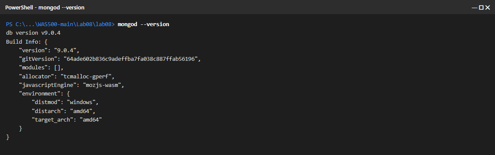

### 2. `mongosh` connected on port 27017 (2.7-2.8)
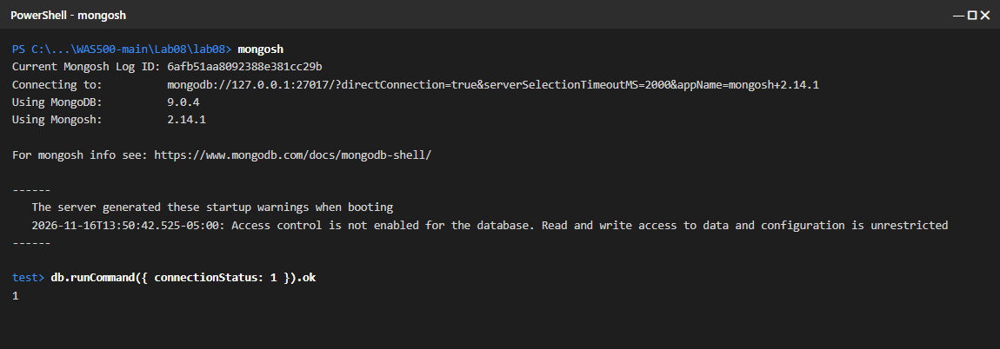

### 3. Create database and collection, `insertMany` of six legends (2.9-2.12)
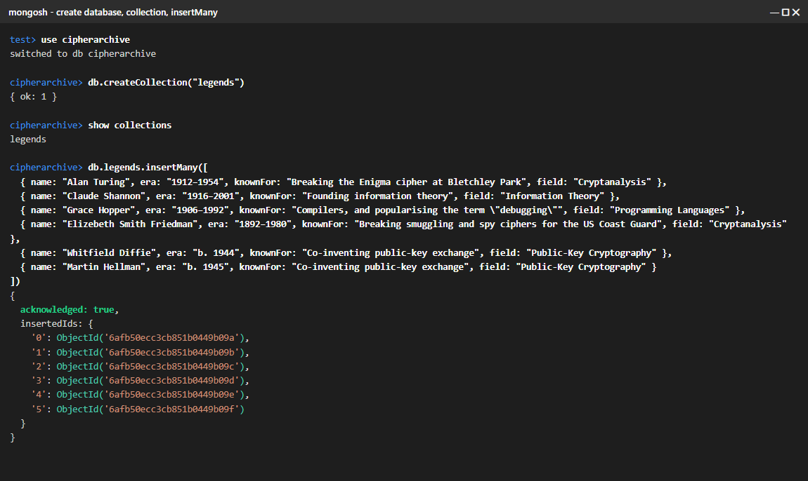

### 4. Examining `_id` (2.13)
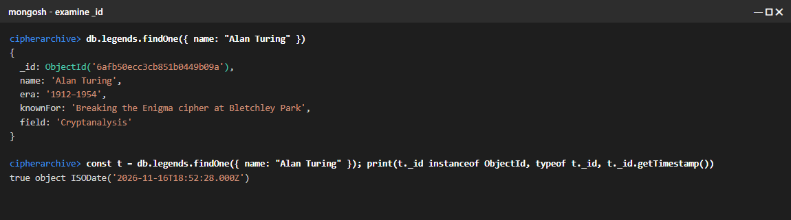

### 5. Query (a) - every legend (2.14)
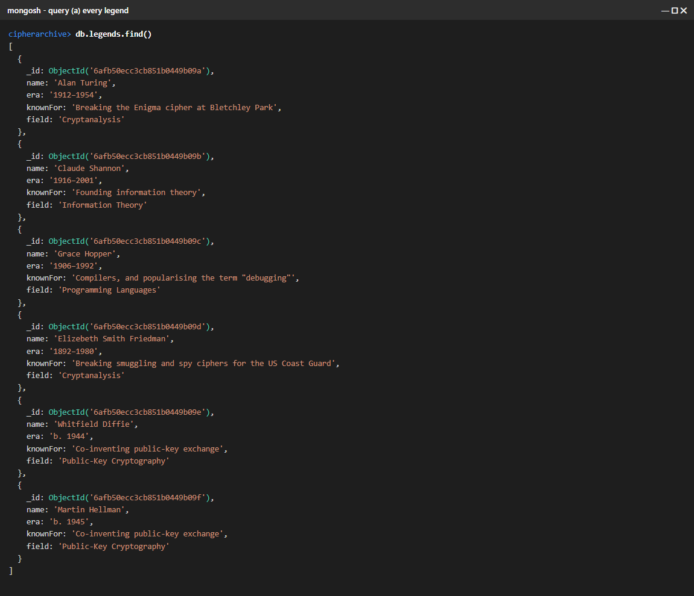

### 6. Queries (b) filter and (c) projection (2.14)
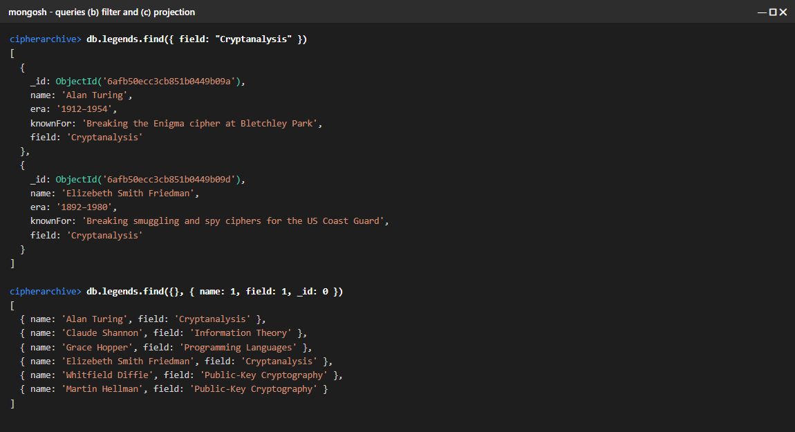

### 7. Queries (d) sort, (e) limit, (f) regex, (g) count (2.14)


### 8a. Updates (a) `updateOne` and (b) `updateMany` (2.16)
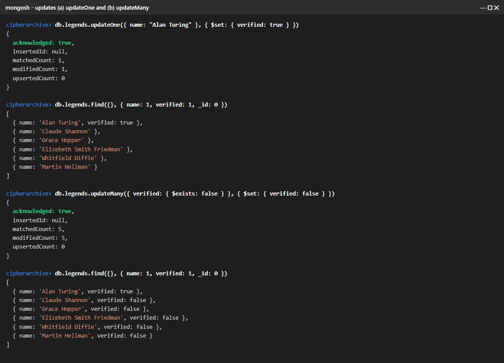

### 8b. Update (c), delete (d) by `_id`, re-insert (e) (2.16)
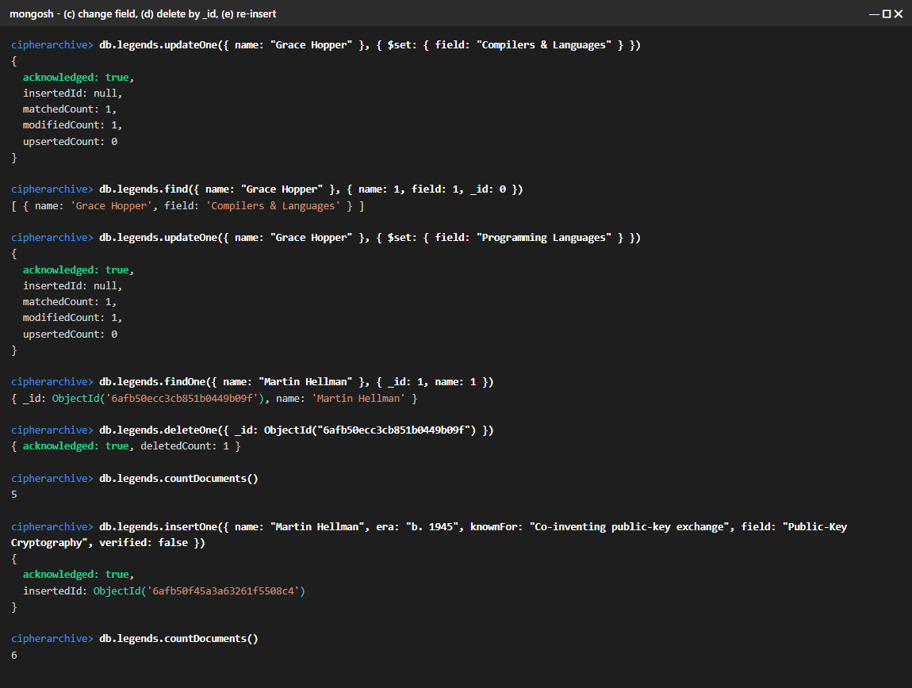

### 9. Compass - `cipherarchive.legends` with six documents (table view) (2.18)


### 10. Compass - same collection, document view (2.18)
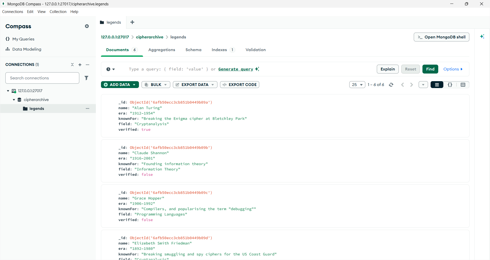

### 11. Project setup - `npm i`, `.gitignore`, `.env.example`, `package.json`, `models/` (2.19-2.21)
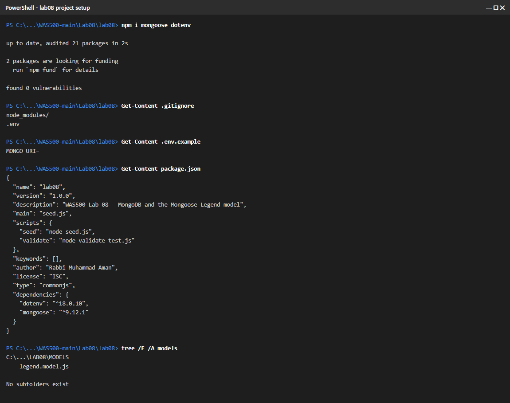

### 12. `npm run seed` - six legends inserted through the model (2.22)
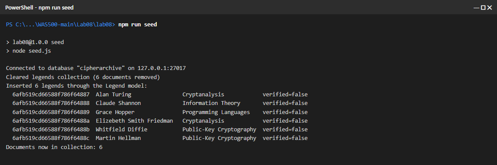

### 13. `npm run validate` - all four invalid saves rejected (2.23-2.24)


### 14. A seeded document (defaults applied) and the unique `name_1` index (2.21-2.22, 2.25.2)
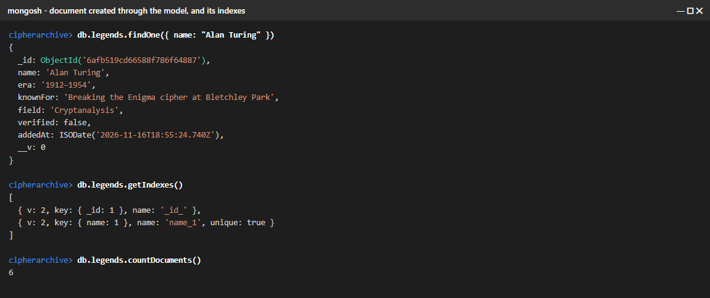

---
## Experience and Challenges
### Reflection on Completing the Lab
- **What did you learn?** I learned that the most important decision occurs before coding: embedding versus referencing determines all queries, so I had to design the legend and annotation documents (and not use an `annotations` array that grows) in Part A first. Using the shell directly made it clear that MongoDB doesn't enforce a schema at all - it accepted an invalid `field` without a complaint - and that `_id` is an `ObjectId` generated by the client, which has a timestamp inside it. Comparing `updateOne` and `updateMany` (matchedCount 1 vs 5) made it clear how dangerous an empty `{}` filter is. Lastly, in Part C, I realized that there are two different layers of validation: Mongoose rules (a-c) run in my Node process, while the `unique` constraint (d) is a database index, and that neither replaces validation at the API boundary from Lab 07.
- **Challenges Faced**: MongoDB was not installed on my laptop, and the Server installer needed admin approval (a UAC prompt) before it would install and register the service. I first tried to launch Compass with an extra command-line option and it refused to start, showing an "Errors while parsing Compass preferences" message. On the Mongoose side, the duplicate-name test is not a Mongoose validation, so it would only fail if the unique index actually existed - on a fresh collection the first test could race with index creation. Mongoose 9 and dotenv 17+ also behave slightly differently from older tutorials (e.g. dotenv prints a log line on load).
- **How You Overcame Challenges**: I installed MongoDB Server, `mongosh` and Compass with `winget`, approved the UAC prompt, and verified with `mongod --version`, `mongosh` and `sc query MongoDB` that the service was running on port 27017. I relaunched Compass with just the connection string, connected to `127.0.0.1:27017`, and opened `cipherarchive.legends`. For the unique constraint, both `seed.js` and `validate-test.js` call `Legend.syncIndexes()` before writing, and I confirmed the `name_1` unique index with `getIndexes()`. I passed `{ quiet: true }` to `dotenv.config()` for clean output, and made `validate-test.js` count documents before and after, so it shows that nothing slipped through, rather than just printing errors.
